# 1. Process flow diagrams

Version 1.0.3 · 20 Oct 2026 · Owner: Yawar (CFO) keeps it current; Tahir approves changes · Rule: R-5h item 1 (D-20)
Changed in the next version (21 Oct 2026; piece 1 of 4; the number is set at the push): 1.21 added: a role is made or changed (D-89, D-90).
Changed in 1.0.3 (20 Oct 2026; 1.0.2 went live on 20 Oct at 11:24): after review, 1.20: take a pack off a list, the description, rows leaving chosen (D-88). 1.20 added: 1 master list and the carry-over into it (D-87); 1.19 Product names keeps official names and O2S spellings only, list rows are no longer settled there.
Changed in 1.0.2 (19 to 20 Oct 2026; 1.0.1 went live on its own on 19 Oct at 23:19): 1.19 added: product names, 1 name everywhere (D-85). 20 Oct 2026: the check of trucks before saving a name change.
Changed in 1.0.1 (19 Oct 2026): 1.17 a list row can be marked "not a C2M pack" and the report colours against each product's target (D-80, D-81); 1.18 the Not placed step in the VAN brand price flow (D-80).
Changed in 1.0.0 (19 Oct 2026): 1.18 added: where each job is done for Yawar and Tahir from 1.0.0, the white label client price flow and the VAN brand price grid flow (D-76 to D-79). 1.15 stands for the other roles.
Changed in 0.9.3 (19 Oct 2026): 1.17 VAN brand list margin added to the Reports flow, with the link step (D-73).
Changed in 0.9.2 (19 Oct 2026): the 12 unbuilt reports carry no version number (built after their pictures are approved).
Changed in 0.9.1 (3 independent reviews, 18 Oct 2026 night): 1.3 approve ticked only leaves the rest in a new item (D-61). Other 0.9.1 logic is in 03, 3.16.
Changed in 0.9.1 (documentation review, 18 Oct 2026): 1.1 cost approval checks every pack is fully costed (D-40); 1.3 rate and packing price saves do not yet leave out waiting packs (I-18), Tahir sees re-approvals under Waiting on others; 1.5 and 1.7 place names; 1.6 refusals (D-40, D-44, D-56); 1.11 2 re-approval items; new diagrams 1.9 to 1.13, new 1.16 Today and 1.17 Reports; 1.15 Reports, 6 Prices views, 5 product page tabs; rule numbers on every step.
Changed in 0.9.0: no flow changed. Where work is done stays as 1.15; Today now orders it (next move, groups, ages: D-54) and Reports join for Yawar and Tahir (D-57).
Changed in 0.8.0: new 1.15 Where each job is done (the screen redesign, D-45 to D-52); place names in 1.3, 1.4, 1.5 and 1.9 moved to the 0.8.0 screens.
Changed in 0.7.0: new 1.14 VAN brand products (D-44).
Changed in 0.6.0: cost approval waits until every pack is costed (D-40); re-approval measured from the approved cost and checked again on approval (D-41).
Changed in 0.4.0 and 0.5.0: rate order (rates Yawar adds beat the base bands); approvals dated ahead wait for their date, only 1 may wait, Tahir can withdraw it; O2S pull lock frees itself after 10 minutes; Tahir sees re-approvals under "For your information"; no real figures in this file (public repo).
Changed in 0.3.0 and 0.3.1: re-approval is now approve all, approve ticked, or close with a reason, and has 8 triggers. New flows: labour and FOH rate choice, Himayat's Materials, VAN list revision, O2S pull, price proposal with dates.

Rule references: R-2 = Design Record section 2; R-5b to R-5i = Design Record sections 5b to 5i; D-xx = 06-decisions.md; F-xx = 09-formulas-and-rules.md.

Legend: each subgraph is a lane (a role and its named owner). A dashed arrow is a send back. A rounded box is a start or end. A diamond is a decision. C2M has no reopen: once approved, an item changes only through a new item (a new recipe version, a new price, a new revision); withdraw (1.6, 1.7) is the only undo, and only before the date. Diagrams are Mermaid; they render on GitHub and in most Markdown viewers. The app's Setup, System documentation, shows the source text.

## 1.1 Recipe (owner: Majid; R-2 People and rights; D-08, D-09; R-5i 1 and 2)

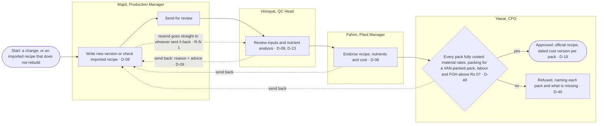

- 1 version in progress per client product (R-2 Recipes).
- A one-time change (e.g. TSP replaced by DAP) is an ordinary new version and goes through all 4 steps; Majid writes another version to switch back (R-5i 2).
- On cost approval the previous approved version becomes "earlier version" and every pack gets a new dated cost version.
- Cost approval is refused, naming the pack, until every pack is fully costed on the version: material rates, a priced packing bill for a VAN-packed pack, a labour and a FOH rate (D-40, 0.6.0).
- The plant is not forced to make the C2M recipe for now (R-5c).

## 1.2 Rate change (owner: Yawar; R-2 Rates; D-10)

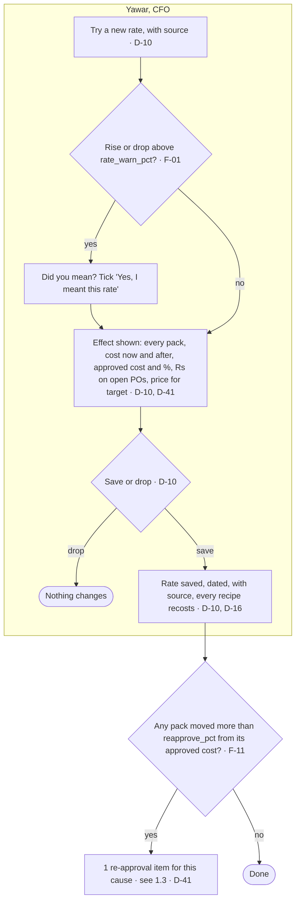
No approval by Tahir for rates (D-10). Packing item prices follow the same flow (D-19).

## 1.3 Re-approval (owner: Yawar; R-2 Cost; R-5i 6; changed in 0.3.1)

Triggers. Each makes 1 item for its cause, holding every pack whose cost now differs from its approved cost by more than reapprove_pct (3%). A pack already waiting in an open item is left out (not yet for a rate save or a packing price save: open issue I-18).
1. A material rate saved (Inputs, Materials).
2. A packing item price saved.
3. A packing bill edited.
4. A packing bill assigned to a pack.
5. A labour or FOH rate added or retired.
6. A product's type changed.
7. A product's reprocessed flag changed.
8. A rate corrected in the import queue.
Also: closing an item makes a new item if packs still differ for another cause (0.3.1).
If a pack's cost moved again between the item being shown and Yawar approving it, C2M approves today's cost and writes "cost moved since shown" in the change record, with the shown and the approved figure (0.5.0).
Each pack shows its last approved cost as "from" and the % against it. On approval each pack is checked again: one now within reapprove_pct of its approved cost, or no longer fully costed, keeps its approved cost and is named (D-41, 0.6.0).

```mermaid
flowchart TB
  T([Trigger 1 to 8]) --> I[Item on Yawar's Today, worked in a panel · R-2 Cost]
  subgraph CFO [Yawar, CFO]
    I --> Q{Decide · R-2 Cost}
    Q -- Approve all, 2 steps --> A1[New dated cost version for every pack still over the % and costed · D-41, D-43]
    Q -- Approve ticked only --> A2{At least 1 ticked? · B-01}
    A2 -- no --> R1[Refused: tick at least 1 pack, or close]
    A2 -- yes --> A3[New cost for ticked packs; the packs not ticked go into a new open item 'Left open from item N' · R-5i 6, D-61]
    Q -- Close: the change was wrong --> Z1[Write why in the box · R-2 Cost] --> Z2[Item closed, approved costs unchanged · R-2 Cost]
  end
  subgraph COO [Tahir, COO]
    V[Sees open items under 'Waiting on others' on Today: with Yawar, re-approve, with its age; Open shows the packs read only; the administrator may approve or close from the route (D-96, replaces D-54)]
  end
  Z2 --> Z3{Packs still differ for another cause? · R-2 Cost}
  Z3 -- yes --> I
  Z3 -- no --> E([Done])
  A1 --> E
  A3 --> E
  I -.-> V
```

## 1.4 Labour and FOH rate choice (owner: Yawar; D-25; R-5i 7; F-05, F-16)

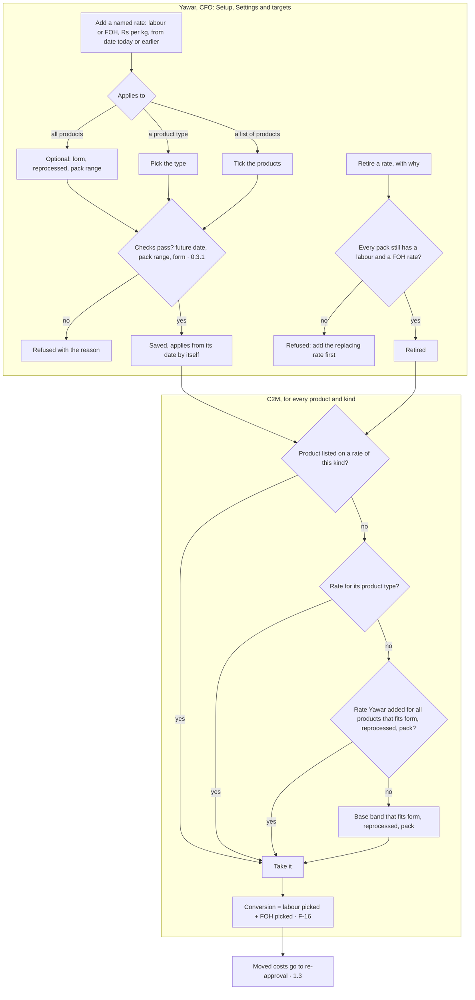
Any rate Yawar adds beats the base bands (D-37). Within a level: more conditions first, then the latest date, then the narrower pack range, then the newest (decision table in 03). The base bands (Rs per kg, set by Yawar; loaded at first load) are 4 rates for all products, marked is_base: solid not reprocessed, solid reprocessed, liquid packs 10 L and above, liquid packs below 10 L. Each band is split into a labour rate and a FOH rate (A-15). Freight inwards is not part of FOH (D-38). The reprocessed flag is set per product (D-30).

## 1.5 Material class and nutrient % on Inputs, Materials (owner: Himayat; D-23, D-48; R-5i 4 and 4a)

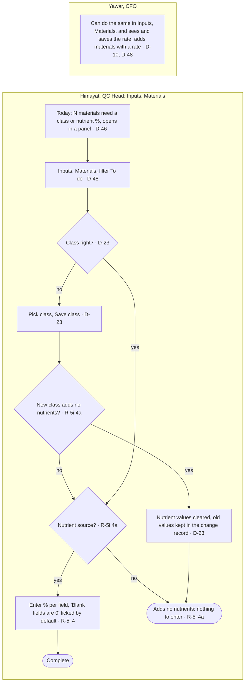
Non-nutrient inputs (binder, filler, anti-caking agent, wetting agent or adjuvant, colour, pH adjuster) count in recipe weight and cost and add 0 to the analysis. No rates or cost are shown on this screen.

## 1.6 Price proposal (owner: Yawar proposes, Tahir approves; R-2 Prices; D-06, D-22, D-34; R-5i 3)

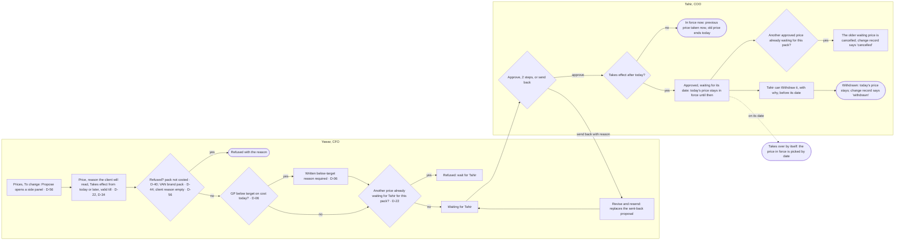
Only 1 approved price may wait for its date per pack. The approve reply is {ok, waitsUntil, cancelled}.

## 1.7 VAN brand list revision (owner: Yawar proposes, Tahir approves; D-28; R-5i 10)

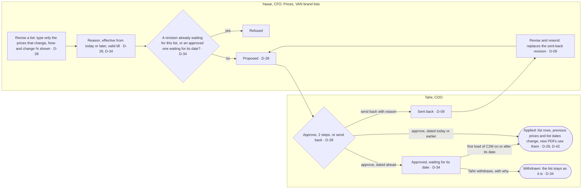
Only 1 revision may wait per list. While an approved revision waits for its date, a new revision of that list is refused: Tahir withdraws it first, or Yawar waits until it takes effect. C2M applies a waiting revision on its first load on or after the date; the change record says "applied", once. The approve reply is {ok, waitsUntil}.
Dealer discount is typed as % on the screen and stored as a fraction, also on revise and resend. Distributor price with FED and dealer net prices are worked out. The previous price on a distributor list is the price on the last distributor list issued (D-42, 0.6.0).

## 1.8 O2S pull (owner: Yawar or Tahir; D-12, D-21)

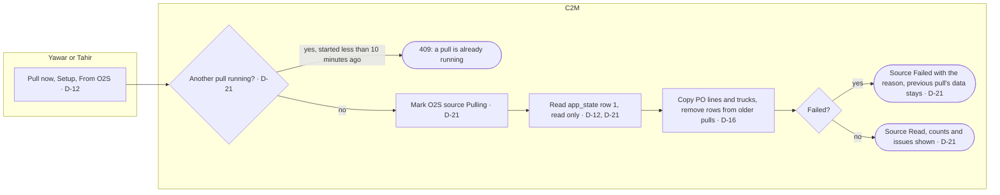
1 pull at a time. A pull left "Pulling" for more than 10 minutes (for example after a crash) frees itself, so the next Pull now runs (0.5.0). C2M never writes to O2S.

## 1.9 Client price rule (owner: Yawar; R-5 client price rule)

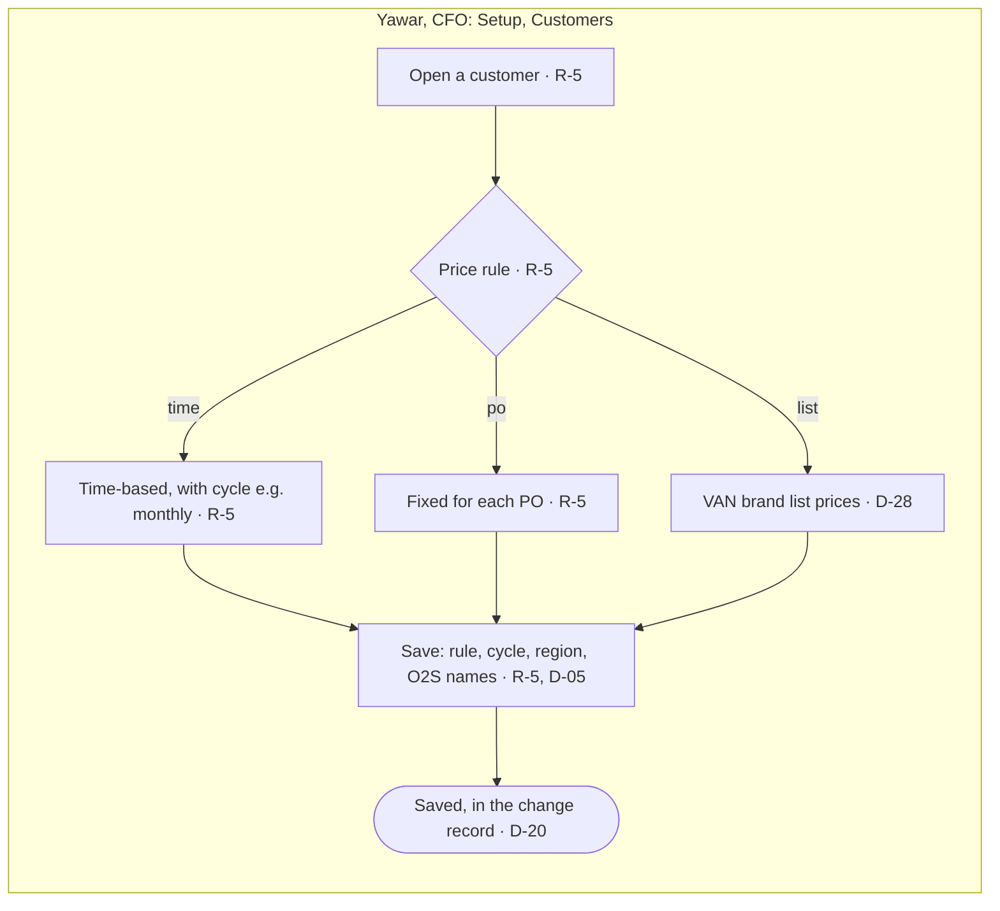
- Time-based (e.g. Client X, monthly): POs received before the effective date are supplied at the PO price.
- PO-based (e.g. Client Y): the price is fixed for that PO.
- Others: to be set by Yawar in Setup, Customers (A-06).

## 1.10 Price list documents (owner: creator; D-14)

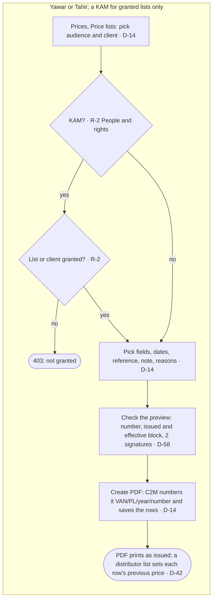
Pick audience, pick fields, set dates and reference, check the document, Create PDF. Cost and margin are never available as fields. With no effective date typed, a white label PDF takes the client's own latest approved price date, and a VAN list PDF takes its own list's dates (0.3.1). A document dated ahead shows the prices in force on that date: waiting list revisions applied over today's rows, and the client prices in force on that date (0.5.0). Every page carries the footer and "page n of N"; there is no blank last page (0.5.0). KAMs download only granted lists, cannot set notes, dates or reasons, and the grant is checked again on download.

## 1.11 Import (owner: Yawar; D-07, R-4)

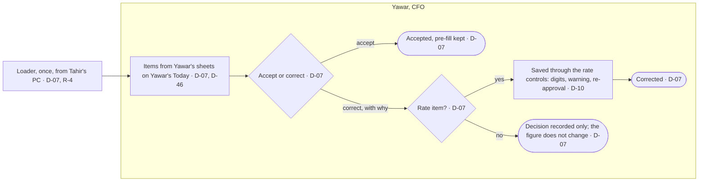
Day-1 masters load from Yawar's sheets with `loader/load-import-pack.js` (in the C2M App folder on Tahir's PC, outside apps/c2m, because the loader and the import pack hold Yawar's figures). Every conflict or data question stays open in Yawar's import queue until he accepts or corrects it. A rate correction passes the rate controls and can make a re-approval item. The 13 Oct cost is loaded as Yawar's sheet; the move to the bands waits in 2 re-approval items, 1 for white label packs and 1 for VAN brand packs (A-19, D-44).

## 1.12 Settings and targets (owner: Yawar proposes, Tahir approves; D-18, D-06)

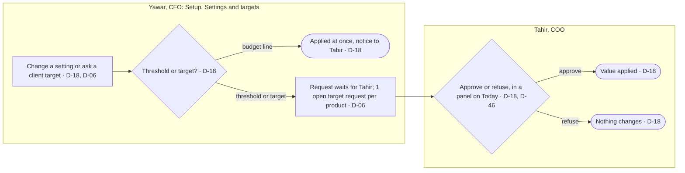
Thresholds (rate warning, re-approval, red flag share and gap, forward horizon) and client target overrides: Yawar proposes, Tahir approves or refuses (2 steps). Only 1 open target request per product. Budget and ambition lines (budget_gp, ambition_gp, wl_budget_gp, conv_budget_month) start at 0 in the migration and are set by the first load; a later change applies at once with a notice to Tahir.

## 1.13 Monthly (owner: Yawar and Tahir; D-18)

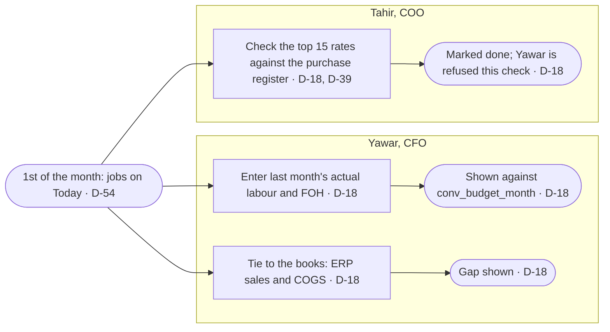
Yawar enters actual labour and FOH; C2M shows them against conv_budget_month. Re-entering a month keeps the earlier values in the change record (0.5.0). Tahir (second person) ties the top 15 rates to the purchase register; Yawar cannot do this check. Yawar enters ERP sales and COGS to tie C2M to the books.

## 1.14 VAN brand products (owner: Yawar; D-44, ruling 8, 18 Oct 2026)

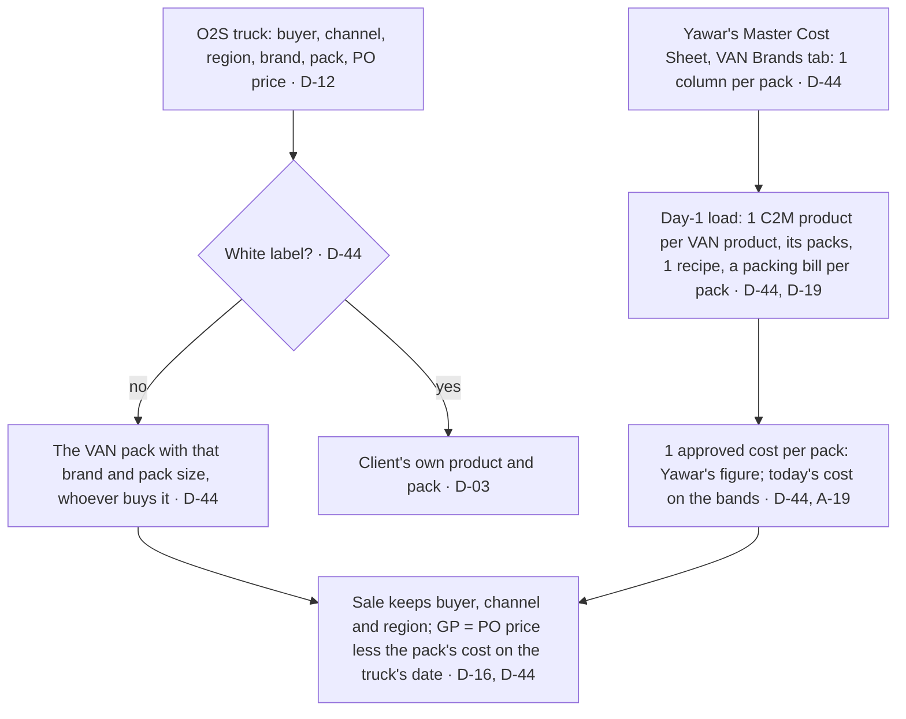
- A product whose packs carry different recipes in Yawar's sheet is held as 2 products (each keeps 1 recipe), e.g. a 3 L pack costed with other quantities.
- A VAN pack has no single price: each channel has its own list. VAN prices change through the VAN brand list revisions (1.7); a per-pack price proposal is refused.
- O2S VAN packs with no costing column load with no cost and are listed in Yawar's import queue.

## 1.15 Where each job is done (owner: Tahir; 0.8.0 and 0.9.0; D-45 to D-59, Tahir's screen rulings of 18 Oct 2026)

Every job and approval starts on the person's Today and is done in a panel there; the screens behind are for looking and for setup. Rules, rights and approval steps are those of 1.1 to 1.14, unchanged.

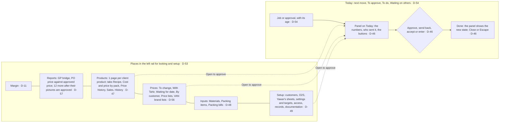

| Job | Who | Opens on Today in a panel |
|---|---|---|
| Check, review, endorse, approve cost of a recipe | Majid, Himayat, Fahim, Yawar | the recipe version, with its steps and buttons (also opened from the product page or Recipes: "Open to ...") |
| Re-approve cost | Yawar (Tahir reads) | the item: approve all, approve ticked, close as wrong |
| Packs not costed | Yawar | each pack with what is missing, and its product page |
| Items from Yawar's sheets | Yawar | the queue: accept or correct |
| Price sent back, prices to change | Yawar | the proposal and its form; the list with Propose |
| List revision sent back | Yawar | the revision and its form |
| Monthly actuals, tie to the books | Yawar | the entry forms |
| Rate check | Tahir | Mark done |
| Approve a price, a list revision, a threshold change, a target change | Tahir | the item and Approve or send back (refuse) |
| Materials to complete | Himayat | the materials table on To do |
| Customers flagged red | Tahir | opens Margin (analysis, not a job) |
| Packs costed with no price | Yawar | opens Prices, To change (D-54) |

## 1.16 Today: the next move (owner: Tahir; D-54, B-12; 0.9.0)

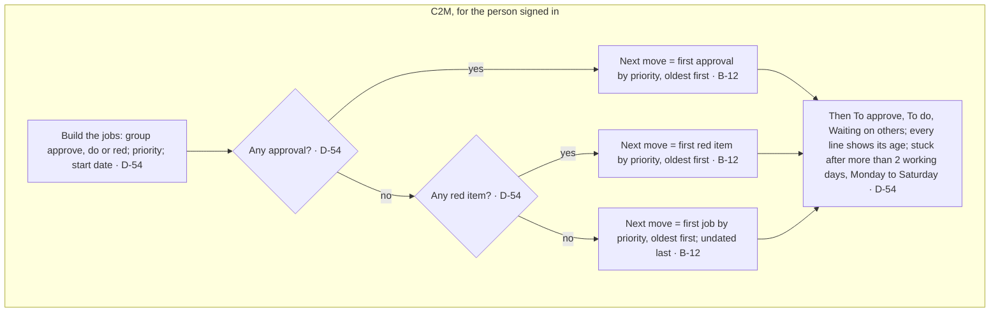

## 1.17 Reports (owner: Yawar and Tahir; D-57; 0.9.0)

```mermaid
flowchart LR
  subgraph People [Yawar or Tahir]
    A[Reports: 14 cards in 4 groups · D-57] --> B{Built? · D-57}
    B -- no --> L([Shows "not built yet": its picture goes to Tahir for approval first · D-57])
    B -- yes, GP bridge --> G[Pick group and month; parts must add up within Rs 1 · F-19]
    B -- yes, PO price --> P[Pick this month, last month or FY to date · F-20]
    B -- yes, VAN brand list margin --> V{Each list row linked to its C2M pack? · D-73}
    V -- no --> K[Yawar checks the suggested pack, picks the rest, Save links, or marks a row Not a C2M pack · D-73, D-80]
    K --> V
    V -- yes --> M[Every VAN pack: GP on each list against cost and its product's GP target; pick the farmer list · F-22, D-81]
    G --> X([Export to Excel])
    P --> X
    M --> X
  end
```

## 1.18 The 1.0.0 places and the 2 price flows (owner: Tahir rules, Yawar proposes, Tahir approves; D-76, D-77, D-78; version 1.0.0, 19 Oct 2026)

Yawar and Tahir work on 5 places: Approvals (the earlier Today), Products, Client prices, Margin and Setup. Reports, Inputs and Guide are under More (Back office was merged into Setup, D-115). Every approval is still done in a panel (D-46).

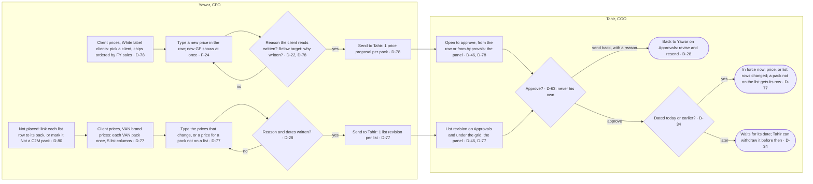

| Step | Owner | Input | Rule | Feeds |
|---|---|---|---|---|
| Pick the client | Yawar | client chips, ordered by FY sales | D-78 | the rows of that client |
| Type a new price | Yawar | price per kg or L | F-24 | new GP %, the send bar's Rs over the forward months (F-12) |
| Send white label prices | Yawar | reason, why below target, from date | D-22, D-78 | 1 proposal per pack (POST /prices/propose) |
| Not placed: link or mark | Yawar | a pack for each list row, or "Not a C2M pack" (no approval; Undo) | D-80, B-24 | the link (POST /lists/links); a marked row no longer blocks an added pack and is left out of the VAN brand list margin report |
| Type VAN brand prices | Yawar | price per pack on each list | D-77, F-25 | 1 revision per list (POST /lists/revise), new rows marked added |
| Approve or send back | Tahir | the panel | D-46, D-63 | price or list in force, or back to Yawar |

## 1.19 Product names: 1 name per product (owner: Tahir and Yawar both edit; Tahir ruled 19 Oct 2026, D-85; version 1.0.2)

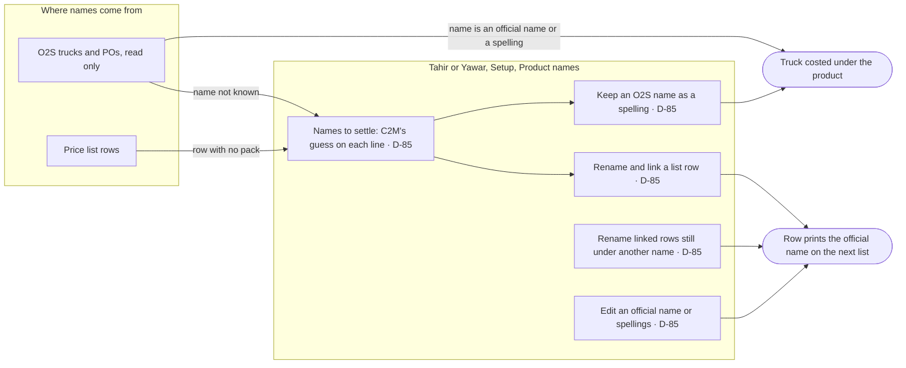

| Step | Owner | Input | Rule | Feeds |
|---|---|---|---|---|
| Settle a list row | Tahir or Yawar | product and pack | D-85, B-26 | link (POST /lists/links); row renamed; old name kept |
| Settle an O2S name | Tahir or Yawar | product | D-85, B-26 | spelling added (POST /names/o2s); trucks costed at once |
| Rename linked rows | Tahir or Yawar | press twice (2 steps) | D-85 | POST /names/rename-linked |
| Edit official name or spellings | Tahir or Yawar | names; then Save anyway if trucks move (20 Oct 2026) | D-85, B-26 | POST /names/product/:id (preview first: trucks that leave or join); list rows follow; name before kept as a spelling |
| Mark not a C2M pack | Yawar | the mark | D-80 | as 1.17 and 1.18 |

## 1.20 1 master list: the 3 price lists print from the master (owner: Tahir rules; Tahir or Yawar carries over; Tahir ruled 20 Oct 2026, D-87; version 1.0.3)

Each VAN brand product and pack is held once, in C2M (the master; only products C2M costs). The distributor, dealer and farmer lists are its price columns: a price belongs to a master pack, and every list prints from the master, under the official name and pack, products A to Z, packs small to large. Today's list rows are carried into the master once.

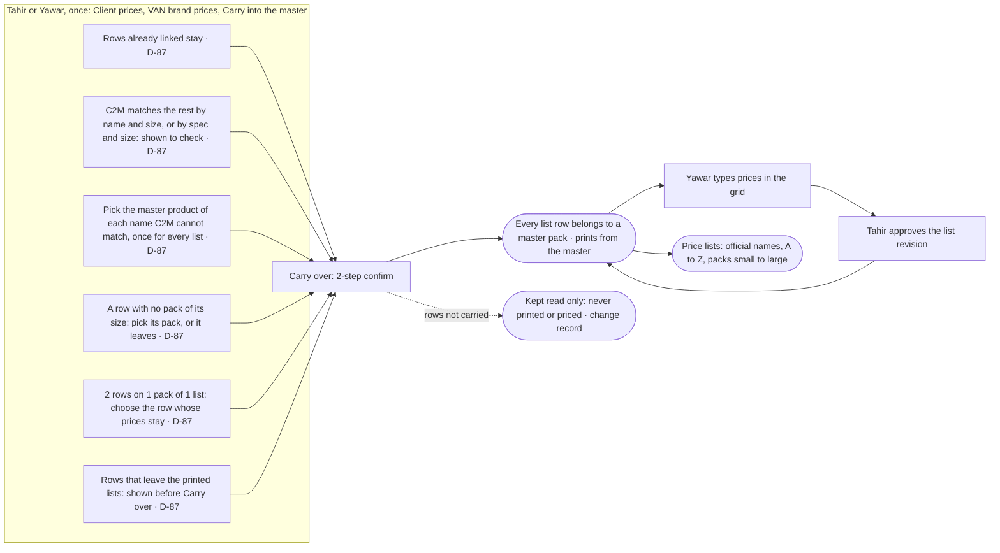

| Step | Owner | Input | Rule | Feeds |
|---|---|---|---|---|
| Open the carry-over | Tahir or Yawar | Carry into the master (grid, Product names, the margin report, the price list builder, or the Approvals panel) | D-87 | POST /lists/master/preview (reads only) |
| Check C2M's matches | Tahir or Yawar | look; change the pick if wrong | D-87, B-27 | the plan is worked again on each change |
| Pick a product | Tahir or Yawar | 1 pick per name, for every list it is on; or "Not in C2M: leaves the lists" | D-87 | the plan |
| Pick a row's pack | Tahir or Yawar | a pack of the row's size (any pack when the row has no size), or "Leaves the lists" | D-87 | the plan |
| Choose between 2 rows | Tahir or Yawar | the row whose prices stay | D-87 | the plan |
| Carry over | Tahir or Yawar | press twice | D-87 | POST /lists/master/carry: links, official names, rows left kept read only, change record; once only |
| A row with no pack of its size | Tahir or Yawar | its pack, or "Leaves the lists" | D-88 | Carry over waits until every such row is chosen |
| After the carry-over | Yawar types, Tahir approves | prices in the grid | D-77 | list revisions as before; a price on the wrong pack is moved in the VAN brand list margin report (2 rows swap in 1 save) |
| Take a pack off a list | Tahir or Yawar, no approval | Take off a list (grid row), why | D-88 | POST /lists/remove: the row stops printing, kept read only with its prices under "Off the lists"; logged; the other is told |
| Description on the lists | Tahir or Yawar | Setup, Product names, Edit, "Description on the price lists" | D-88 | POST /names/product/:id/spec: all 3 lists print it |

## 1.21 A role is made or changed (next version; D-89, D-90)

```mermaid
flowchart TD
  A[Tahir or Ahmer Shehzad opens Setup, Roles] --> B{New role or an existing one?}
  B -->|New| C[Name it and tick what it may do]
  B -->|Existing| D[Pick it and change the ticks]
  C --> E[Create role]
  D --> F[Save role]
  E --> G[(c2m_role, change record)]
  F --> G
  G --> H[Takes effect at the next request of everyone holding it]
  D --> I{Delete?}
  I -->|a person holds it| J[Refused: move them first in People and access]
  I -->|nobody holds it| K[Deleted, logged]
```

| Step | Owner | Input | Rule | Feeds |
|---|---|---|---|---|
| Open Setup, Roles | Administrator role | pick or New role | D-89, D-90 | GET /roles |
| Tick actions | Administrator role | the ticks and the name | D-90 | POST /roles or /roles/:key |
| Give the role to a person | Tahir, platform People and access | the person and the role | D-90 | user_module_roles |

## KAM lists: who sees which price list (D-97)

```mermaid
flowchart LR
  T[Tahir or Yawar: Setup, KAM lists] --> P[Pick a manager]
  P --> A[Tick price lists and client chips: each tick saves at once]
  P --> B[Copy from another manager: replaces his ticks]
  P --> C[See what this person sees: read only]
  A --> G[(c2m_list_grant)]
  B --> G
  G --> K[The KAM opens Price lists: only what is ticked, approved prices only]
  A --> L[(change record)]
  B --> L
```

A manager with nothing ticked sees "No price list is granted to you yet. Ask Tahir or Yawar". Nobody is told when something is granted: Tahir or Yawar tells the manager.

## 1.22 Add a client, add a product, add a variant (owner: Tahir rules; Tahir or Yawar add; Majid adds a variant; D-94, D-95, D-98; piece 3)

```mermaid
flowchart TD
  A["Setup, Clients and buyer lines: Add client (Tahir or Yawar)"] --> B{"What does it buy?"}
  B -->|VAN brand| C["Saved: matched by the name O2S writes"]
  B -->|White label or Both| D["Step 2: Add a product"]
  D --> E{"Follows a VAN product's recipe?"}
  E -->|yes| F["Takes the approved material cost of that VAN product"]
  E -->|no| G["Majid writes its own recipe; Himayat, Fahim, Yawar approve"]
  F --> H["Packs: size, packing bill, who supplies the packing, only for this client"]
  G --> H
  H --> I["Yawar approves the packing bill and, for a follower, presses Approve cost; Yawar sets the price"]
  V["Add a variant (Majid, Tahir or Yawar)"] --> W["New VAN product; recipe is a copy of the main one, a draft"]
  W --> G
```

Rate order for a pack: the client's pack, the variant, the product type, the general rate. When a followed VAN recipe is approved, each fully costed pack of its followers gets a new approved cost.

### MRP printing list (26 Oct 2026, D-122)
Yawar changes a Sindh credit price on Client prices, VAN brand prices (the send bar warns if any price would be above the new MRP) -> Tahir approves the list revision -> on its date the farmer prices are in force -> printed MRP = Sindh credit price rounded up to the next Rs 50 (no credit price: the higher of Punjab and Sindh) -> Yawar makes the MRP printing list on Client prices, Price lists, for packing and the printer. Any list price above its MRP is a job on Approvals and a line on Margin. FRP and Recommended MRP (suggested prices) are changed with the buttons under the VAN brand grid.

### Round 4 (26 Oct 2026, D-124 to D-132)
- Why did a pack's margin move? Margin, open the line, open the pack: each truck shows its PO price, the price approved on its date and the cost on its date with its parts; Open the product goes to the Cost tab.
- Who changed it? Setup, Record and checks, Change record: pick the person, the kind or the dates, or search a name, then Show.
- First cost of old packs: the first time Yawar or Tahir opens this version, packs with no approved cost wait on Approvals in 1 item; Yawar approves them like any re-approval.
- A VAN brand list revision that would put a price above the printed MRP is named in Tahir's panel before he approves; he may approve.
