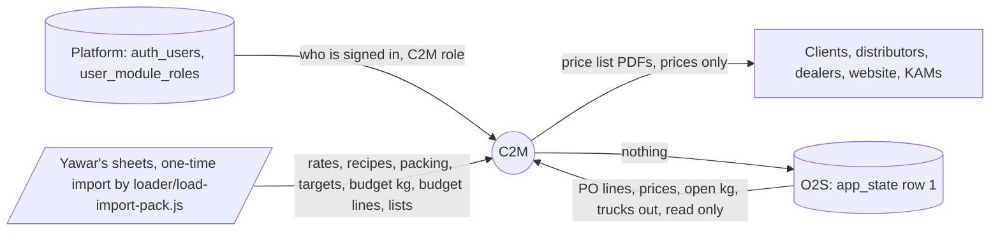
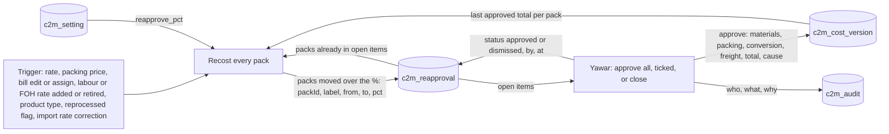
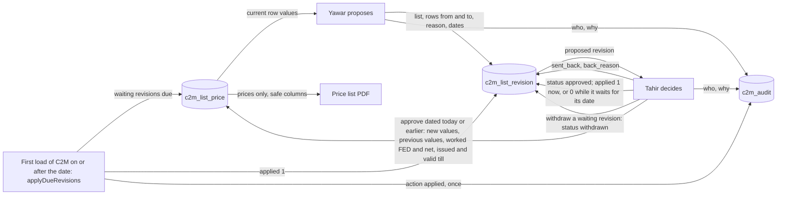
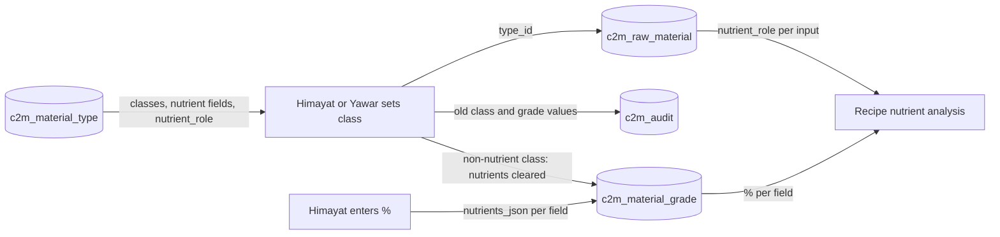
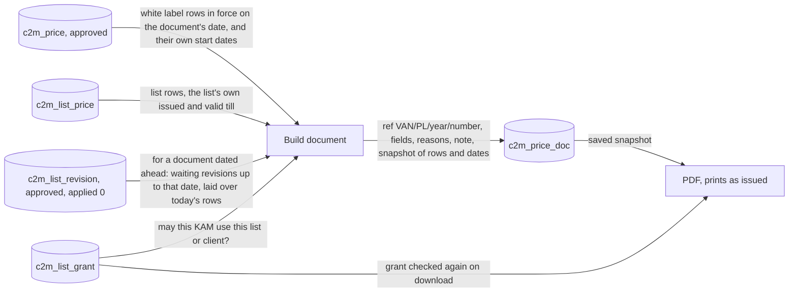

# 2. Data flow diagrams

Version 1.4 · 18 Oct 2026 · Owner: Yawar; data links set by Tahir and Yawar in Setup, From O2S · Rule: R-5h item 2 (D-20)
Changed in 0.9.0: the state adds read-only fields for Yawar and Tahir (price history, PO lines, import date, next document number) built from tables C2M already holds; nothing new is read from O2S and nothing is written (D-58).
Changed in 0.8.0: place names only (Setup, From O2S); no data flow changed (D-45 to D-52).
Changed in 0.7.0: O2S line matching for VAN brand packs (D-44).
Changed in 0.4.0 and 0.5.0: 4 levels of rate choice (base bands last, is_base); list revisions wait for their date (applied) and can be withdrawn; prices picked by the date in force; price documents dated ahead; loader path; restated history on the margin board.
Changed in 0.3.0 and 0.3.1: conversion line fixed (1 labour + 1 FOH rate, 3 levels). New Level 1 flows: re-approval, list revision, material class, price document snapshot. KAM data filter shown.

Style: close to Yourdon/DeMarco. A cylinder is a data store, named as its real table. A rectangle is a process. A parallelogram is an outside source. Each arrow says what data moves. Rule references as in 01.

## 2.1 Level 0: context (owner: Tahir; D-01, D-12, D-21)

C2M writes to no other system (D-12). O2S holds no recipes; C2M is the recipe master; other apps may read C2M recipes later (14 Oct). The loader and the import pack stay in the C2M App folder on Tahir's PC, outside apps/c2m; they never go to the public repo.

## 2.2 Level 1: O2S pull (owner: Yawar or Tahir; D-21; code c2m-o2s.js)

| Step | Reads | Writes |
|---|---|---|
| 1 | c2m_source (claim: status to Pulling, only if not already Pulling, or Pulling for more than 10 minutes) | c2m_source.status, last_pull_note "Pulling since ..." |
| 2 | app_state.data (orders, shipments) | c2m_sync_run (start) |
| 3 | each order line | c2m_o2s_po_line: net price (FED-inclusive / 1.05, free 0), ordered, dispatched, open kg (0 if short-closed or "Old POs") |
| 4 | each shipment not voided, with a known line | c2m_o2s_truck: date (approvedDate, else dispatch), kg |
| 5 | rows from older pulls | deleted from c2m_o2s_po_line and c2m_o2s_truck |
| 6 | customers not matched | c2m_sync_run.issues_json; c2m_source status Read (or Failed with the reason) |

## 2.3 Level 1: cost (owner: Yawar; D-16, D-19, D-25; code c2m-engine.js)

| Input store | Data moved | Used for |
|---|---|---|
| c2m_recipe_version, c2m_recipe_line | approved version's lines (grade, qty per kg) | materials |
| c2m_material_rate | latest rate per grade | materials |
| c2m_client_pack → c2m_packing_bill → c2m_packing_bill_line → c2m_packing_item, c2m_packing_rate | items, level, pieces, packs per outer, latest price per piece | packing per kg (F-04) |
| c2m_conversion_rule (with is_base) + c2m_conversion_rule_product, with c2m_client_product (base_product_id, form, reprocessed) and pack size | 1 labour rate and 1 FOH rate picked, each by level: listed products, then product type, then rates Yawar added for all products, then the base bands (is_base = 1); each checks form, reprocessed and pack range; only active rates dated today or earlier | conversion = labour + FOH (F-05, F-16) |
| c2m_freight_rate, c2m_customer.region | segment x region | freight (dealer, farmer only) |
| c2m_cost_version | dated approved totals | margin on each truck by its date; re-approval base |

## 2.4 Level 1: margin board (owner: Tahir; D-11, D-15, D-27)
c2m_o2s_truck + c2m_o2s_po_line are matched to c2m_client_pack: a white label line by customer name in c2m_customer.o2s_names, brand, channel group and pack; any other line by brand and pack alone to the VAN brand pack (D-44), with the buyer, channel and region kept on the sale. c2m_client_product.o2s_brand may hold other O2S spellings separated by |. Each truck takes the cost in force on its date (c2m_cost_version), or, with the switch "restated at today's labour and FOH rates", the truck's approved cost with today's labour and FOH rates in place of its conversion, for costs that came from Yawar's sheets (D-35). The price in force on a date comes from c2m_price (approved, valid_from on or before the date, valid_to after it). GP by customer, product, PO. Open PO lines give the locked-in gap at each line's own price. Forward exposure: expected kg = budget kg (c2m_client_product.budget_kg_year / 12 x forward_months) or the last 3 months' run rate, chosen by a switch on the screen (not saved), less kg already on open POs.

## 2.5 Level 1: re-approval (owner: Yawar; R-2 Cost; 1.3)

## 2.6 Level 1: VAN list revision (owner: Yawar and Tahir; D-28; 1.7)

## 2.7 Level 1: material class (owner: Himayat; D-23; 1.5)

## 2.8 Level 1: price list documents and the snapshot (owner: creator; D-14)

The snapshot sits in c2m_price_doc.fields_json. A reprint uses it, so the document never changes after issue. With no effective date typed, a white label document takes the client's latest approved price date; a VAN list document takes its own list's dates.

## 2.9 What leaves the server for a KAM (owner: Tahir; R-2 People and rights; 0.3.1)
Only these list columns: p, d, pack, prev, now, fed, mrp, terms, nsv, disc, net, netfed, frp, pb, sn, snc. Farmer columns only for granted farmer lists. No cost, no margin, no settings, no products, no recipes. Documents: 07 and 11 only.
