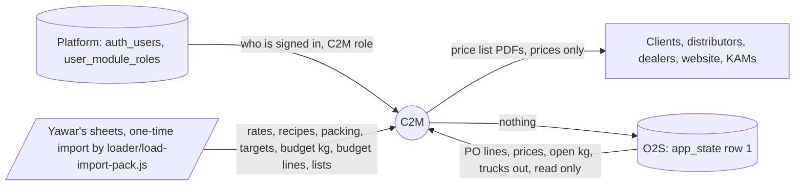
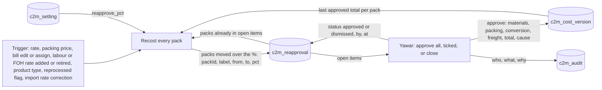
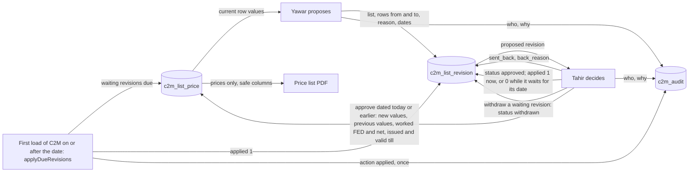
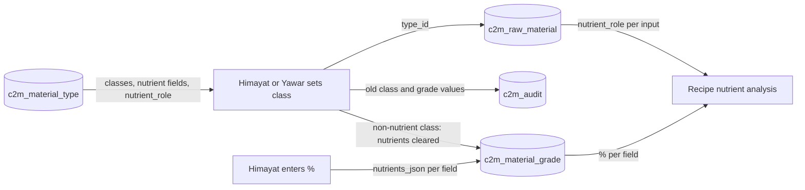
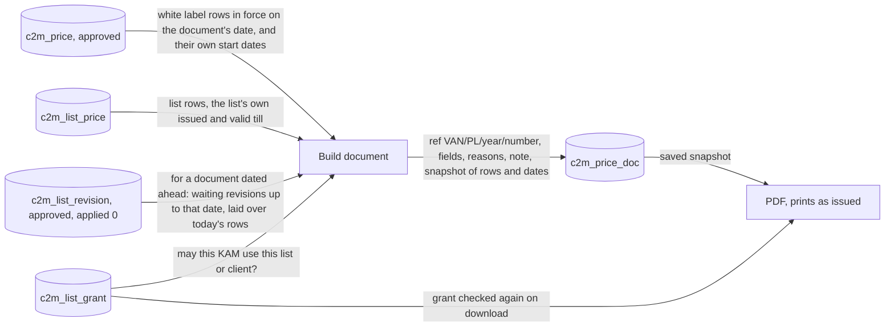

# 2. Data flow diagrams

Version 1.0.3 · 20 Oct 2026 · Owner: Yawar; data links set by Tahir and Yawar in Setup, From O2S · Rule: R-5h item 2 (D-20)
Changed in the next version (21 Oct 2026; piece 1 of 4): 2.21 added: roles (D-89, D-90).
Changed in 1.0.3 (20 Oct 2026; 1.0.2 went live on 20 Oct at 11:24): 2.20 added: the carry-over into the master and printing from the master (D-87).
Changed in 1.0.2 (19 to 20 Oct 2026; 1.0.1 went live on its own on 19 Oct at 23:19): 2.19 added: product names (D-85). 20 Oct 2026: row 8 (the check of trucks).
Changed in 1.0.1 (19 Oct 2026): 2.18 added: the "not a C2M pack" mark on a list row (D-80).
Changed in 1.0.0 (19 Oct 2026): 2.17 added: buyer lines from O2S (D-74) and the added list row (D-77).
Changed in 0.9.2 (19 Oct 2026): step 3 divides FED-inclusive PO prices by (1 + FED %), the setting fed_pct (D-72).
Changed in 0.9.1 (3 independent reviews, 18 Oct 2026 night): step 4 counts a truck only with its gate pass (D-60); 2.16 FOC and notices (D-62, D-63).
Changed in 0.9.1 (documentation review, 18 Oct 2026): 2.2 a truck counts only with its gate pass (approvedDate, D-60), issues list and change record; 2.4 the price in force uses valid_to as the last day; new level 1 flows 2.10 to 2.15 (recipe chain, price proposal, setting and target requests, import queue, monthly checks and grants, Reports and the 0.9.0 state fields).
Changed in 0.9.0: the state adds read-only fields for Yawar and Tahir (price history, PO lines, import date, next document number) built from tables C2M already holds; nothing new is read from O2S and nothing is written (D-58).
Changed in 0.8.0: place names only (Setup, From O2S); no data flow changed (D-45 to D-52).
Changed in 0.7.0: O2S line matching for VAN brand packs (D-44).
Changed in 0.4.0 and 0.5.0: 4 levels of rate choice (base bands last, is_base); list revisions wait for their date (applied) and can be withdrawn; prices picked by the date in force; price documents dated ahead; loader path; restated history on the margin board.
Changed in 0.3.0 and 0.3.1: conversion line fixed (1 labour + 1 FOH rate, 3 levels). New Level 1 flows: re-approval, list revision, material class, price document snapshot. KAM data filter shown.

Style: close to Yourdon/DeMarco. A cylinder is a data store, named as its real table. A rectangle is a process. A parallelogram is an outside source. Each arrow says what data moves. Rule references as in 01.

## 2.1 Level 0: context (owner: Tahir; D-01, D-12, D-21)


C2M writes to no other system (D-12). O2S holds no recipes; C2M is the recipe master; other apps may read C2M recipes later (14 Oct). The loader and the import pack stay in the C2M App folder on Tahir's PC, outside apps/c2m; they never go to the public repo.

## 2.2 Level 1: O2S pull (owner: Yawar or Tahir; D-21; code c2m-o2s.js)

| Step | Reads | Writes |
|---|---|---|
| 1 | c2m_source (claim: status to Pulling, only if not already Pulling, or Pulling for more than 10 minutes) | c2m_source.status, last_pull_note "Pulling since ..." |
| 2 | app_state.data (orders, shipments) | c2m_sync_run (start) |
| 3 | each order line | c2m_o2s_po_line: net price (FED-inclusive / (1 + FED %), fed_pct, 5 now; free 0), ordered, dispatched, open kg (0 if short-closed and not reopened, or "Old POs") |
| 4 | each shipment not voided, with a known line | c2m_o2s_truck: date (approvedDate: the gate pass approval), kg. A truck still loading has no approvedDate and is left out until its gate pass (D-60) |
| 5 | rows from older pulls | deleted from c2m_o2s_po_line and c2m_o2s_truck |
| 6 | customers not matched; prices below Rs 10 | c2m_sync_run.issues_json; c2m_source status Read (or Failed with the reason); c2m_audit (action pull, with the counts) |

## 2.3 Level 1: cost (owner: Yawar; D-16, D-19, D-25; code c2m-engine.js)

| Input store | Data moved | Used for |
|---|---|---|
| c2m_recipe_version, c2m_recipe_line | approved version's lines (grade, qty per kg) | materials |
| c2m_material_rate | latest rate per grade | materials |
| c2m_client_pack → c2m_packing_bill → c2m_packing_bill_line → c2m_packing_item, c2m_packing_rate | items, level, pieces, packs per outer, latest price per piece | packing per kg (F-04) |
| c2m_conversion_rule (with is_base) + c2m_conversion_rule_product, with c2m_client_product (base_product_id, form, reprocessed) and pack size | 1 labour rate and 1 FOH rate picked, each by level: listed products, then product type, then rates Yawar added for all products, then the base bands (is_base = 1); each checks form, reprocessed and pack range; only active rates dated today or earlier | conversion = labour + FOH (F-05, F-16) |
| c2m_freight_rate, c2m_customer.region | segment x region | freight (dealer, farmer only) |
| c2m_cost_version | dated approved totals | margin on each truck by its date; re-approval base |

## 2.4 Level 1: margin board (owner: Tahir; D-11, D-15, D-27)
c2m_o2s_truck + c2m_o2s_po_line are matched to c2m_client_pack: a white label line by customer name in c2m_customer.o2s_names, brand, channel group and pack; any other line by brand and pack alone to the VAN brand pack (D-44), with the buyer, channel and region kept on the sale. c2m_client_product.o2s_brand may hold other O2S spellings separated by |. Each truck takes the cost in force on its date (c2m_cost_version), or, with the switch "restated at today's labour and FOH rates", the truck's approved cost with today's labour and FOH rates in place of its conversion, for costs that came from Yawar's sheets (D-35). The price in force on a date comes from c2m_price (approved, valid_from on or before the date, valid_to empty or on or after it: valid_to is the last day the price applies). GP by customer, product, PO. Open PO lines give the locked-in gap at each line's own price. Forward exposure: expected kg = budget kg (c2m_client_product.budget_kg_year / 12 x forward_months) or the last 3 months' run rate, chosen by a switch on the screen (not saved), less kg already on open POs.

## 2.5 Level 1: re-approval (owner: Yawar; R-2 Cost; 1.3)



## 2.6 Level 1: VAN list revision (owner: Yawar and Tahir; D-28; 1.7)



## 2.7 Level 1: material class (owner: Himayat; D-23; 1.5)



## 2.8 Level 1: price list documents and the snapshot (owner: creator; D-14)


The snapshot sits in c2m_price_doc.fields_json. A reprint uses it, so the document never changes after issue. With no effective date typed, a white label document takes the client's latest approved price date; a VAN list document takes its own list's dates.

## 2.9 What leaves the server for a KAM (owner: Tahir; R-2 People and rights; 0.3.1)
Only these list columns: p, d, pack, prev, now, fed, mrp, terms, nsv, disc, net, netfed, frp, pb, sn, snc. Farmer columns only for granted farmer lists. No cost, no margin, no settings, no products, no recipes. Documents: 07 and 11 only (the route serves them; the KAM's state carries no document list yet, I-35).

## 2.10 Level 1: recipe chain (owner: Majid to Yawar; D-08, D-09, D-16; code c2m-routes.js recipes)

| Step | Reads | Writes |
|---|---|---|
| Majid writes a version | c2m_recipe_version (1 in progress per product), c2m_recipe_line of the version copied | c2m_recipe_version (draft), c2m_recipe_line, c2m_recipe_step (written), c2m_audit |
| Each step: send, review, endorse | c2m_recipe_version.state, locked FOR UPDATE | c2m_recipe_version.state, c2m_recipe_step (sent, resent, reviewed, endorsed), c2m_audit |
| Send back (reason + advice) | c2m_recipe_version.state | sent_back_by, sent_back_state, sent_back_reason, sent_back_advice; c2m_recipe_step (sent_back); c2m_audit |
| Yawar approves cost | rates, packing, conversion rules (every pack fully costed, D-40) | c2m_recipe_version (approved; the previous approved becomes old), c2m_cost_version per pack, c2m_recipe_step (cost_approved), c2m_audit |

## 2.11 Level 1: client price proposal (owner: Yawar proposes, Tahir approves; D-06, D-22, D-34, D-40, D-56)

| Step | Reads | Writes |
|---|---|---|
| Yawar proposes | pack cost today (c2m-engine packCost), target_gp, c2m_price in force (prev price), open proposals | c2m_price (proposed: price, reason, below_target_reason, valid_from, valid_to); a sent-back proposal it replaces becomes replaced; c2m_audit |
| Tahir approves | c2m_price waiting for its date for the same pack | new row approved (valid_from = later of its date and today, prev_price, cut_price_id, cut_prev_to); price in force gets valid_to = the day before; an older waiting price becomes cancelled; c2m_notice to Yawar when one is cancelled; c2m_audit |
| Tahir sends back | c2m_price (proposed) | status sent_back, back_reason; c2m_audit |
| Tahir withdraws a waiting price | c2m_price (approved, valid_from after today), c2m_price_doc issued with it | status withdrawn; the shortened price gets cut_prev_to back; c2m_notice to Yawar; c2m_audit (withdrawn, end restored) |

## 2.12 Level 1: setting and target requests (owner: Yawar proposes, Tahir decides; D-18, D-06)

| Step | Reads | Writes |
|---|---|---|
| Yawar changes settings | c2m_setting (needs_approval) | budget lines: c2m_setting at once, c2m_notice to Tahir, c2m_audit; thresholds: c2m_setting_request (open) |
| Yawar asks a client target | c2m_client_product.target_gp, open c2m_target_request (1 per product) | c2m_target_request (open), c2m_audit |
| Tahir approves or refuses | the request, locked | request status approved or refused; on approval c2m_setting.v or c2m_client_product.target_gp; c2m_audit |

## 2.13 Level 1: import queue (owner: Yawar; D-07, D-10)

| Step | Reads | Writes |
|---|---|---|
| Accept | c2m_import_item (open) | status accepted, decided_by, decided_at, decision_note; c2m_audit |
| Correct | c2m_import_item (open), payload | status corrected, decision_note; a rate item also writes c2m_material_rate and can write c2m_reapproval (rate controls); c2m_audit |

## 2.14 Level 1: monthly checks and list grants (owner: Yawar and Tahir; D-18, R-2 People and rights)

| Step | Reads | Writes |
|---|---|---|
| Yawar enters actuals | c2m_monthly_actual (old values) | c2m_monthly_actual; c2m_audit with the old values |
| Tahir's rate check, Yawar's tie to the books | c2m_monthly_check (old values) | c2m_monthly_check (rate_check by coo only, tie_books by cfo only); c2m_audit |
| Yawar grants or removes a list or client | user_module_roles (person has a C2M role), c2m_customer | c2m_list_grant (insert or delete); c2m_audit |
| Tahir or Yawar copies a manager's grants to another, ticks or clears all clients (D-97) | user_module_roles, c2m_list_grant (the source), c2m_customer | c2m_list_grant (delete then insert for the target, or insert or delete the clients); c2m_audit with the old and the new grants |
| Tahir or Yawar looks at a manager's screen (D-97) | the same data the manager would get (c2m_list_grant for him, the price lists, white label prices) | nothing: read only; the page refuses every save while it shows |

## 2.15 Level 1: Reports and the 0.9.0 state fields (owner: Tahir; D-55, D-57, D-58; read only, cfo and coo)

| State field | Read from | Used by |
|---|---|---|
| priceHistory | c2m_price: approved, or replaced with no send-back reason (an approved price a newer one ended) | Product page, Price history; PO price report (F-20) |
| poLines | c2m_o2s_po_line received in this financial year (from 1 Jul), matched to a pack | PO price against approved price (F-20) |
| sales | c2m_o2s_truck + c2m_o2s_po_line, with the cost in force on the truck's date (c2m_cost_version) | GP bridge (F-19), Margin |
| importedAt | earliest c2m_recipe_step.at with action imported | age of the items from Yawar's sheets on Today |
| nextDocRef | count of c2m_price_doc this year + 1 | number shown on the price list preview |
| fam, typeName | c2m_base_product (product types in id order) | family colour chip and type name (every role that receives products) |
Nothing is written. Export to Excel is made in the browser.

## 2.16 Flows added in 0.9.1 (owner: Yawar; version 0.9.1, 18 Oct 2026)

| From | Data | To | Rule |
|---|---|---|---|
| c2m_o2s_truck and c2m_o2s_po_line (net_price 0) | FOC trucks with the approved cost on their date | state foc (cfo, coo), the customer page | D-62, ruling 14b |
| c2m_price (approved, valid_to passed, none in force) | last price and its last day | state priceEnded per pack; Prices "price ended" | D-62 |
| Labour and FOH rate, packing bill, product type, reprocessed saves | what changed and how many packs moved | c2m_notice (for_role coo), Tahir's Today | D-63 |
| Tahir's and Yawar's monthly check entries, with C2M's own month figures | register rates; ERP and C2M sales and COGS | c2m_monthly_check.data_json; state checks.data | D-64 |

## 2.17 Level 1: buyer lines and the added list row (owner: Tahir rules the sync, Yawar keeps the lists; D-74, D-77; version 1.0.0, 19 Oct 2026)

```mermaid
flowchart LR
  O[(c2m_o2s_po_line: customer_name, channel)] -->|customer, channel on each PO| BL[c2m-lib buyerLine · D-74]
  T[(c2m_o2s_truck)] -->|kg, gate pass date| S
  BL -->|cat and line: named for white label, distributors, dealers; COBO; VGreen; Farmers and other| S[GET /api/c2m/state: sales, foc, open, poLines carry cust and cat]
  S --> M[Margin chips and lines · D-79]
  S --> C[Client prices, client chips by FY sales · D-78]
  G[Client prices, VAN brand prices: a price for a pack not on a list] -->|items {id null, packId, values}| R[(c2m_list_revision.items_json: added 1)]
  R -->|Tahir approves| L[(c2m_list_price: new row, data_json with packId and the derived prices)]
```

- Nothing new is stored for a buyer line: it is worked out on every read from the O2S category on the PO. A farmer's name is read from O2S but never sent to the page (cust is "Farmers and other", region empty).
- The added row is written only when Tahir approves (or on its date), through the same apply step as any revision (applyRevision).

## 2.18 The "not a C2M pack" mark (owner: Yawar; Tahir ruled 19 Oct 2026, D-80; version 1.0.1)

| Step | From | To | Data that moves | Rule |
|---|---|---|---|---|
| 1 | Yawar, Client prices (Not placed) or Reports, VAN brand list margin | POST /api/c2m/lists/links | {id, noPack: true} or {id, noPack: false} | D-80 |
| 2 | links route | c2m_list_price.data_json | noPack = 1, noPackBy (user), noPackAt (date); packId taken out. Undo or a link takes the 3 keys out | D-80, B-24 |
| 3 | links route | c2m_audit | list_price, not_c2m_pack (old: the pack id or null; new: "not a C2M pack") or not_c2m_pack_undone | D-80 |
| 4 | c2m_list_price | GET /api/c2m/state listItems (cfo and coo only; never the KAM) | the row with its mark | D-80 |
| 5 | listItems | the grid, the report and POST /lists/revise | a marked row is not counted as "not linked"; it is left out of the report; the list prints it as before | D-80, B-24 |

## 2.19 Product names (owner: Tahir and Yawar; D-85; version 1.0.2)

| Step | From | To | Data that moves | Rule |
|---|---|---|---|---|
| 1 | Tahir or Yawar, Setup, Product names | POST /api/c2m/names/product/:id | official name, O2S spellings | D-85 |
| 2 | names route | c2m_client_product.brand, o2s_brand | official name; spellings separated by \| (at most 120 characters) | D-85, B-26 |
| 3 | names route | c2m_list_price (data_json p, pack; columns product, pack) | every row linked to the product's packs takes the new name | D-85 |
| 4 | links route | c2m_list_price | a link renames the row (listName, listP, listPack keep its first name); an unlink gives that name back | D-85 |
| 5 | POST /api/c2m/names/o2s | c2m_client_product.o2s_brand | an O2S name added as a spelling | D-85 |
| 6 | c2m_o2s_po_line, c2m_o2s_truck (O2S copy) | matcher (engine) | a VAN brand line is placed on brand and pack size, by the official name or any spelling | D-44, D-85 |
| 7 | every step above | c2m_audit | product_name rename or o2s_names (old and new, with trucks and Rs moved), list_price link, rename | D-85 |
| 8 | c2m_o2s_po_line, c2m_o2s_truck (O2S copy) | names route, preview | the trucks a name change would move off or onto the product, with Rs and first date, before saving; read only | D-85, review 1.0.2 |

## 2.20 1 master list (owner: Tahir rules; Tahir or Yawar; D-87; version 1.0.3)

| Step | From | To | Data that moves | Rule |
|---|---|---|---|---|
| 1 | c2m_list_price (dist, dealer, farmer), c2m_client_product, c2m_client_pack | POST /api/c2m/lists/master/preview | the plan: rows already linked, groups of rows by name with C2M's guess, 2-row choices, rows that leave, a signature; nothing is written | D-87, B-27 |
| 2 | the carry-over screen | POST /api/c2m/lists/master/carry | the picks, choices and row picks, with the signature of the plan seen | D-87 |
| 3 | carry route | c2m_list_price data_json (packId, p, pack; listName, listP, listPack keep the name before) and columns product, pack | each carried row linked to its master pack under the official name | D-85, D-87 |
| 4 | carry route | c2m_list_price.list_name dist_old, dealer_old, farmer_old; data_json.left {at, by, why} | a row not carried, kept as it was, read only | D-87 |
| 5 | carry route | c2m_audit | list_price link (each row carried), left_list (each row that left), list_master carried (once: the flag) | D-87 |
| 6 | c2m_list_price, c2m_client_pack, c2m_client_product | state lists, price list documents, the KAM's lists | after the carry-over each row prints under its master pack's official name and pack, products A to Z, packs small to large; rows of the _old lists never | D-87 |
| 7 | the issued distributor list | c2m_list_price data_json prev | the price printed becomes each row's previous price, matched by master pack (after the carry-over; by name before it) | D-42, D-87 |
| 8 | Take off a list (POST /api/c2m/lists/remove) | c2m_list_price list_name <list>_old, data_json.left; c2m_audit left_list with the prices; c2m_notice to the other person | the row off the list, its prices kept | D-88 |
| 9 | Product names, Edit (POST /api/c2m/names/product/:id/spec) | c2m_client_product.spec; c2m_audit product_name spec (before and after) | the description all 3 lists print | D-88 |
| 10 | carry route | c2m_list_revision status replaced (revisions Tahir sent back); c2m_notice to Yawar and to the other person | closed at the carry-over; told | D-87 |

## 2.21 Roles (next version; D-89, D-90)

| From | Data | To | When |
|---|---|---|---|
| Administrator (Setup, Roles) | label, ticked actions | c2m_role (and c2m_audit) | on Create, Save, Delete |
| user_module_roles (platform) | the person's role key | C2M, each request | every request |
| c2m_role | the role's actions | C2M, each request | every request; if the table is missing the 6 built-in roles are used |
| C2M | actions, admin, nav | the page (state.me, /me) | page load and after each change |

## 2.22 Clients, products, variants (piece 3; owner: Tahir; D-94, D-95, D-98)

The forms write to c2m_customer, c2m_client_product, c2m_client_pack and the 5 link tables (c2m_product_family, c2m_product_variant, c2m_product_ext, c2m_pack_ext, c2m_rule_variant); every write is also a row in c2m_audit. The engine reads the link tables in loadAll (empty when migration 003 has not run). A follower's cost reads the followed product's approved recipe (recipeOwner), its own packs and bills, and the rate picked by client pack, variant, type, general. O2S is read only: a brand name O2S writes is matched to a product by the matcher, and the variant is carried in the name.

### Printed MRP (26 Oct 2026, D-122)
c2m_list_price (farmer rows, by packId) -> lib.printMrp -> the MRP printing list (POST /pricedocs audience mrp, snapshot stored with the document) and lib.mrpIssues (state.mrpIssues: farmer, dealer and distributor rows of the same pack) -> Approvals job, Margin line. Nothing is stored for the MRP itself: it is worked out from the prices in force.

### Round 4 (26 Oct 2026, D-124, D-125)
- c2m_cost_version (version on the truck date) → each sale's `parts` in GET /state → Margin drill-down. c2m_price (Price history) → approved price on the truck date, worked out in the page.
- c2m_audit → GET /api/c2m/audit, joined in the route to client products, packs, prices, recipe versions, materials, packing items and bills, rules, target and setting requests, list revisions and price documents for their names → Change record. Read only.

## 2.23 Out of use and the Default recipe (owner: Tahir; D-139, D-140; migration 007)
- Take out of use writes 1 row in c2m_out_of_use (material grade, packing item, packing bill, client); Put back deletes it. The state call sends outOfUseKeys ("customer:12") and the pickers leave those items out unless already picked. No cost is recalculated: approved costs keep the item.
- Delete writes the old values to c2m_audit (action delete) and removes the rows. Its uses are read from: recipe lines (materials), packing bill lines (packing items), client packs (packing bills), today's pack costs (labour and FOH, freight), client products, O2S PO lines, KAM grants and issued price lists (clients), recipe versions, approved costs, prices, followers, VAN list rows, open re-approvals, waiting targets and O2S lines (products).
- The Default recipe: c2m_recipe_default holds the recipe name per product (none = "Main"); c2m_recipe_name holds a version's name (none = "Main"). The engine's approvedVersion picks the Default's approved version; Make default writes c2m_cost_version rows (cause "Default recipe set to ...") for the product and its followers, and 1 notice for Tahir.
