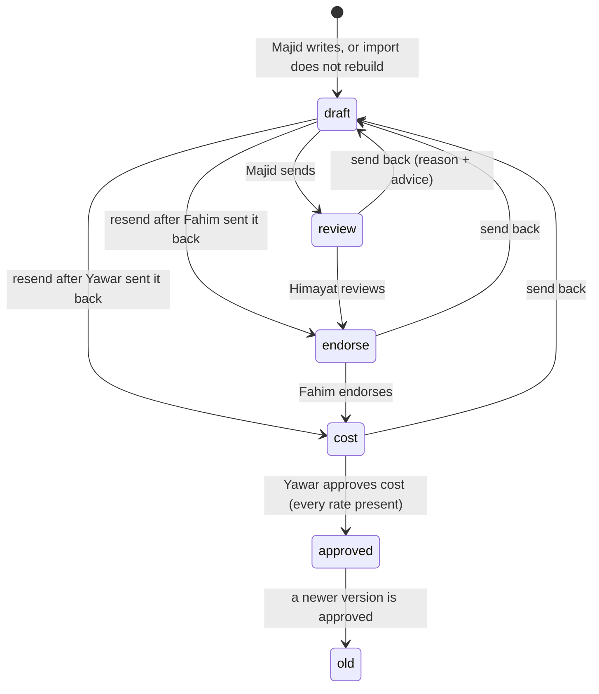
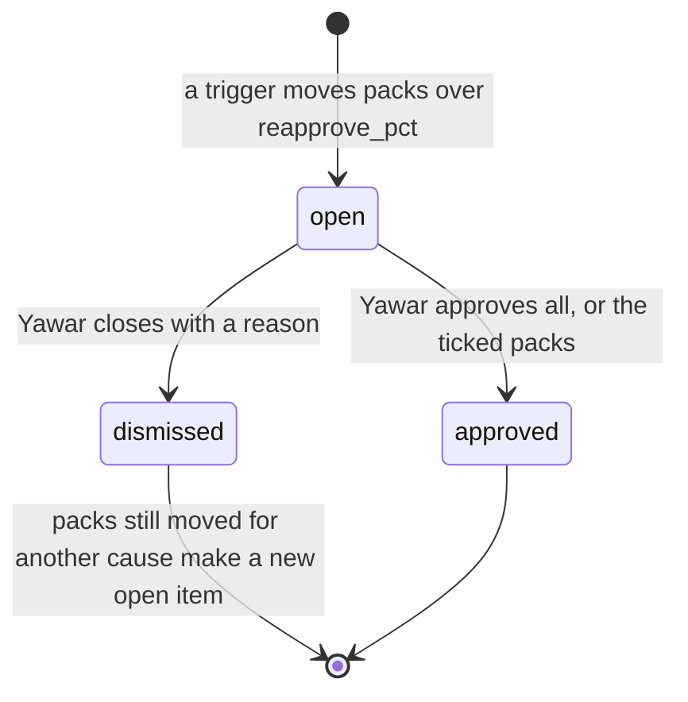
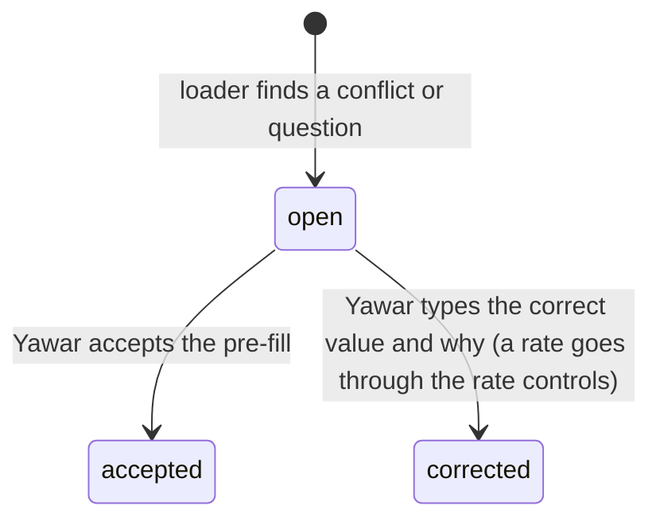
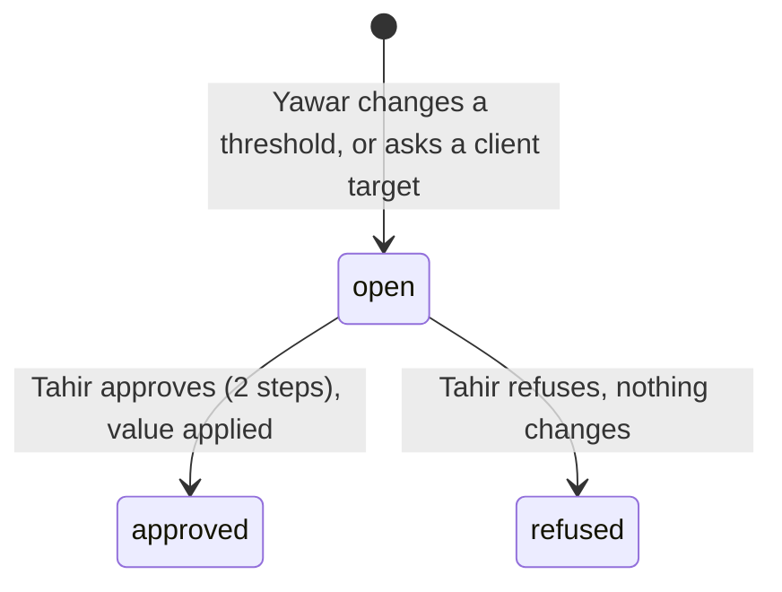

# 3. System logic

Version 1.0.3 · 20 Oct 2026 · Owner: Yawar; Tahir approves changes · Rule: R-5h item 3 (D-20)
Changed in the next version (21 Oct 2026; piece 1 of 4 after Tahir's rulings D-89 to D-95; the version number is set at the push; 1.0.3 is live): 3.22 added: how a person's rights are worked out (actions on a role, the administrator, the proposer rule, the fallback before migration 002).
Changed in 1.0.3 (20 Oct 2026; 1.0.2 went live on 20 Oct at 11:24): 3.21 added: the carry-over into the master and the lists printed from it (D-87).
Changed in 1.0.2 (19 to 20 Oct 2026; 1.0.1 went live on its own on 19 Oct at 23:19): 3.20 added: product names (D-85). 20 Oct 2026, after review: 2 people saving at once, the check of trucks before a name change, names before a rename kept, a trade name shared across pack sizes, revisions shown under today's names.
Changed in 1.0.1 (19 Oct 2026): 3.19 added: the "not a C2M pack" mark, the report against each product's target, the Margin left-out line and the History tab (D-80 to D-83).
Changed in 1.0.0 (19 Oct 2026): 3.18 added: buyer lines, targets, the client price state, the VAN brand price grid, Margin and its red rule (D-74 to D-79); 3.17 says a revision can add a row.
Changed in 0.9.3 (19 Oct 2026): 3.17 added: the VAN brand list margin (D-70, D-72, D-73).
Changed in 0.9.1 (3 independent reviews, 18 Oct 2026 night): 3.16 added (D-60 to D-65).
Changed in 0.9.1 (documentation review, 18 Oct 2026): 3.3 when "replaced" is written; 3.4 Tahir sees re-approvals under Waiting on others; 3.10 where "Not costed" shows; 3.12 a wrong mount answers 503; 3.13 stuck marks on every waiting line (D-54); 3.15 the full priority list and what Waiting on others holds; owners on 3.2 and 3.13.
Changed in 0.9.0: new 3.15 how Today orders the work and counts age (D-54).
Changed in 0.7.0: new 3.14 matching an O2S line to a pack, and VAN brand sales (D-44).
Changed in 0.6.0: 3.4 re-approval figures and the check on approval (D-41); 3.10 when a pack is costed (D-40) and the base of a rate save.
Changed in 0.4.0 and 0.5.0: price and list revision states with waiting, cancelled and withdrawn; rate choice has 4 levels (base bands last) and the tie-break is more conditions first; flag wording; mount needs the pool, dates as text, prepared statements; stuck flag built.
Changed in 0.3.0 and 0.3.1: the 409 message replaces "Already decided". New state diagrams: re-approval, list revision, import item, setting request, target request. New decision tables: labour and FOH rate choice, nutrient_role. Price proposal states drawn.

Rule references as in 01.

## 3.1 Recipe version states (owner: Majid to Yawar; D-08, D-09, R-5i 1)



## 3.2 Decision table: who acts at each recipe step (owner: Majid to Yawar; D-08)

| State | Who acts | Can send back | Next | Refused when |
|---|---|---|---|---|
| draft | production (Majid) | no | review, or the step that sent it back | no lines |
| review | qc (Himayat) | yes | endorse | not his step |
| endorse | plant (Fahim) | yes | cost | not his step |
| cost | cfo (Yawar) | yes | approved | a material has no rate; a pack has no labour or no FOH rate (0.3.1) |

## 3.3 Price proposal states (owner: Yawar and Tahir; D-22, R-5i 3)

```mermaid
stateDiagram-v2
  [*] --> proposed: Yawar proposes (1 open per pack), with Takes effect from
  proposed --> in_force: Tahir approves, dated today or earlier; prev price taken now
  proposed --> waiting: Tahir approves, dated ahead (status approved, valid_from after today)
  proposed --> sent_back: Tahir sends back with reason
  sent_back --> replaced: Yawar revises and resends (new proposal)
  waiting --> in_force: its date comes (picked by date, nothing is written)
  in_force --> replaced: a newer price takes over, valid_to = the day before it starts
  waiting --> withdrawn: Tahir withdraws it; the shortened price gets its old end back
  waiting --> cancelled: a newer approval for the pack; the shortened price gets its old end back
```


"in_force" and "waiting" are both status approved; the date decides. Status "replaced" is written only when the new price starts on the day it is approved; a price ended by a price dated ahead keeps status approved, with valid_to set to the day before the new one starts. Only 1 price may wait for its date per pack. When a waiting price is cancelled or withdrawn, the price in force loses the end date it was given, so it stays in force.

## 3.4 Re-approval item states (owner: Yawar; R-2 Cost, R-5i 6)


Tahir sees open items under "Waiting on others" on his Today (with Yawar, re-approve, with their age; not counted as jobs); Open shows the packs read only (0.9.0, D-54). Since D-96 he may approve or close them himself, because the administrator holds every action.
Each pack in an item shows from = its last approved cost, to = its cost after the change, and % against the approved cost (D-41, 0.6.0). On approval C2M recosts each pack today and checks it again: a pack now within reapprove_pct of its approved cost, or no longer fully costed, keeps its approved cost; the reply lists it under "left" and the change record says "left: within threshold" or "left: not costed". A costed pack with no approved cost yet joins an item made by any other trigger (e.g. a packing bill assigned) as "first cost" (from blank); approving it sets its first approved cost without the % check.

## 3.5 VAN list revision states (owner: Yawar and Tahir; D-28)

```mermaid
stateDiagram-v2
  [*] --> proposed: Yawar proposes (1 open per list; refused while an approved revision of the list waits)
  proposed --> applied: Tahir approves, dated today or earlier (status approved, applied 1); list rows and dates change
  proposed --> waiting: Tahir approves, dated ahead (status approved, applied 0)
  proposed --> sent_back: Tahir sends back with reason
  sent_back --> replaced: Yawar revises and resends (new revision)
  waiting --> applied: first load of C2M on or after its date (applyDueRevisions; audit "applied", once)
  waiting --> withdrawn: Tahir withdraws with why (audit "withdrawn"); Yawar gets a notice
  applied --> [*]
```

## 3.6 Import item states (owner: Yawar; D-07)



## 3.7 Setting request and target request states (owner: Yawar proposes, Tahir decides; D-18, D-06)


Budget and ambition lines (needs_approval = 0) apply at once with a notice to Tahir; no request is made.

## 3.8 Decision table: labour and FOH rate choice (owner: Yawar; D-25, R-5i 7; code c2m-lib.js pickConversionRule)

Run once for labour and once for FOH. Only active rates with valid_from today or earlier count. Every level also checks the rate's form, reprocessed and pack range against the product (formOk and inPack; list rates too, from 0.3.1). First level with a match wins (D-37).

| Level | Rate qualifies when | Example |
|---|---|---|
| 1 | The product is on the rate's list (c2m_conversion_rule_product, or the old scope_client_product_id) | "Liquid filling labour" ticked for 2 products |
| 2 | Not a list rate, and scope_base_product_id = the product's type | FOH for a product type such as "Product type T" |
| 3 | Not a list rate, no product type, is_base = 0: a rate Yawar added for all products | "Labour, all liquids" |
| 4 | Not a list rate, no product type, is_base = 1: the base bands | The base bands (Rs per kg, set by Yawar; loaded at first load) |

So any rate Yawar adds beats the base bands for the products it covers.

| Tie-break inside a level, in order | Wins |
|---|---|
| 1. Number of conditions (form, reprocessed, pack min, pack max) | more conditions |
| 2. valid_from | the latest date |
| 3. Pack range width (max less min) | the narrower range |
| 4. id | the newest |

Pack range: from scope_pack_min (included) to below scope_pack_max. No rate found for a kind: that kind is 0, and cost approval and rate retire are refused for that pack (0.3.1).

## 3.9 Decision table: nutrient_role (owner: Himayat; D-23, R-5i 4a; code c2m-engine.js nutrients)

| nutrient_role | Fields asked | In recipe weight and cost | Adds to analysis | Shown to Himayat as | Analysis complete? |
|---|---|---|---|---|---|
| nutrient | the class's fields, e.g. K% | yes | qty x % per field | "to enter: field" until every field has a value, then "complete" | only when every field has a value |
| none | none | yes | 0; listed as a non-nutrient input with its kg | "adds no nutrients" (never "to enter") | yes |
| unclassified | none | yes | nothing; listed as "to classify" | "to classify" | no |

Saving a class with role none or unclassified clears the grade's nutrient values; the old values stay in c2m_audit.

## 3.10 Rate save (owner: Yawar; D-10)
Warning when abs(new - last) / last > rate_warn_pct (rise or drop). Refused without a source. Refused above the warning without "Yes, I meant this rate". Digits only. After save: 1 re-approval item for the packs that moved more than reapprove_pct from their approved cost (D-41); a material's first rate batches packs the same way. A pack with no approved cost yet is not batched by a rate save; a pack of an inactive product is skipped (0.6.0).
Costed (D-40): a pack shows a cost only when every material has a rate; a VAN-packed pack has a packing bill with at least 1 item, every item priced above Rs 0, and a pack size above 0 (bulk, and client-packed with no bill: packing 0); and a labour and a FOH rate apply. A rate of Rs 0 (material, labour or FOH) counts as missing. Otherwise the product page (Cost and price by pack) and Recipes show "Not costed" with what is missing, Yawar's Today lists the pack when its recipe is approved, no price can be proposed for it (also when its recipe is not in C2M yet, D-40), and cost approval is refused naming the pack (checked before and again inside the transaction).

## 3.11 Flags (owner: Tahir; D-17, R-5f)
Below cost: red. Below target by more than red_gap_pts AND Rs gap above red_share_pct % of all white label sales in the period: red (D-31). More than red_gap_pts below target but a small Rs gap: amber "N pts below target, small Rs". Within red_gap_pts of target: amber "slightly below target". Below budget: amber. Else green. No target and no budget: grey "no target", never green. A missing target stays blank, never 0.

## 3.12 Two people saving at once (owner: Tahir; 0.2.0, 0.3.1 and 0.5.0)
C2M needs the platform's mysql2 promise pool, because transactions and the guards below depend on it. Without it (or without pdq and auth), every /c2m and /api/c2m request gets 503 "C2M is not set up: ... Ask IT." and the platform keeps running (0.5.0 second review round). A startup check reads a date from the database; if the pool does not return dates as text (mysql2 option dateStrings: true), every /api/c2m request gets 503 "C2M needs the database pool to return dates as text ... Ask IT." Every query runs as a prepared statement (pool.execute); a list in a query gets 1 placeholder per value (IN (?,?,?)).
Each action is 1 request inside 1 transaction. It locks the row it changes (SELECT ... FOR UPDATE) and updates only if the row is still in the expected state (e.g. a recipe still at the caller's step; a price still "proposed"; a re-approval still "open"). If someone else changed it first, nothing changes and the person gets 409:
"Someone else changed this a moment ago. Check before retrying."
Routes that can return it are listed in 05, section 5.3. The O2S pull has its own 409: "A pull is already running. Wait a minute, then look again." The pull lock frees itself after 10 minutes.
One exception: sending back a price that is no longer proposed gives 400 "Nothing to send back."

## 3.13 Lateness, escalation, hand over, stand in, away (owner: Tahir; D-33, D-54)
Built (0.4.0, D-33): a recipe more than 2 working days at 1 step (Sundays off) shows on Tahir's Today as "Recipe stuck N working days". No message leaves C2M.
Built (0.9.0, D-54): every waiting line on every person's Today shows its age in days and is marked "stuck" after more than 2 working days, Monday to Saturday (see 3.15).
Not built (not ruled): escalation, due dates, hand over, stand in and away. Nobody stands in for another role. Recorded as open issue I-01 in 12.

## 3.14 Matching an O2S line to a pack (owner: Yawar; D-44; code c2m-engine.js matcher)

| O2S line | C2M pack | Sale shows |
|---|---|---|
| White Label channel | The client's own product (customer name in o2s_names, brand, pack) | The client |
| Any other channel, a customer's own product exists | That product (kept for old data) | That customer |
| Any other channel | The VAN brand pack with that brand (or another O2S spelling in o2s_brand) and pack size | The O2S buyer, its channel (COBO, VGreen, Dealer, Distributor, Farmer) and region |
| No pack found | None: the sale counts in sales with no cost and is listed under "Sales C2M could not place" | The O2S buyer |

A VAN brand pack shows no single price (each channel has its own list); a per-pack price proposal for it is refused. Freight is not added to VAN brand costs (none is loaded); freight by the sale's channel and region is not built (I-25).

## 3.15 How Today orders the work and counts age (owner: Tahir; D-54, B-12; code c2m.html jobs(), nextMove(), waitingOn())
Each job knows its group (approve, do, or red), its priority and the date it started waiting: the last recipe step, the proposal date, the re-approval date, the date the sheets were loaded, or the 1st of the month for monthly entries. The next move is the first approval by priority (recipe and cost steps 1, prices 2, re-approvals and list revisions 3, thresholds and targets 5), oldest first; else the first red item by priority, oldest first; else the first job by priority, oldest first. Jobs with no start date sort after dated ones.

| Priority | Yawar (cfo) | Tahir (coo) | Majid, Himayat, Fahim |
|---|---|---|---|
| 1 | recipe at the cost step (approve) | | recipe at their step (approve; Majid's draft is a do) |
| 2 | price sent back, list revision sent back (do) | approve price | |
| 3 | re-approval (approve); client prices to change (do) | approve list revision | |
| 4 | packs costed with no price (red) | recipe stuck (red) | |
| 5 | packs not costed (do) | approve threshold change, approve target | Himayat: materials to complete (do) |
| 6 | items from Yawar's sheets (do) | customers flagged red (red) | |
| 7 | monthly actuals, tie to the books (do) | monthly rate check (do) | |

Age is in calendar days; stuck is more than 2 working days, Monday to Saturday. Waiting on others lists items with someone else: for every recipe role, recipes at another person's step; for Yawar, his prices, list revisions, threshold and target requests waiting for Tahir; for Tahir, the re-approvals waiting for Yawar (a stuck recipe shows as his job instead). The rail's number is the count of jobs.

## 3.16 Logic added in 0.9.1 (owner: Yawar for cost and prices, Tahir for controls; version 0.9.1, 18 Oct 2026)

| When | C2M does | Rule |
|---|---|---|
| A pull reads a shipment with no approvedDate (still loading) | Leaves it out; it becomes a truck on the first pull after its gate pass | D-60, ruling 14 |
| Yawar approves only the ticked packs of a re-approval item | Approves those; puts the others still beyond reapprove_pct (or with no approved cost) in a new open item "Left open from item N" | D-61 |
| An FOC line (price 0) has trucks or open kg | Keeps them out of sales, GP, open POs and Rs at stake; lists the trucks on their own with their cost | D-62, ruling 14b |
| An approved price passes its last day and no other is in force | The pack has no price; it shows as costed with no price ("price ended") until a new price is approved | D-62, ruling 3 |
| A price is approved for a later date | Rs at stake counts the current gap until that date and the gap at the new price after it | D-62 |
| Someone approves a price, list revision, setting or target they proposed | Refused (403); refusing your own request is allowed | D-63, ruling 19 |
| Yawar adds or retires a labour or FOH rate, changes a packing bill or gives one to a pack, or changes a product type or the reprocessed tick | Saves it, raises any re-approval, and puts a notice on Tahir's Today with the packs moved | D-63, ruling 12 |
| Tahir saves the rate check, or Yawar the tie to the books | Refused until every register rate, or both ERP figures, are entered | D-64 |
| On a screen, a product type, reprocessed or packing bill change is picked | Nothing is saved until Save; Cancel drops it | D-65 |
| C2M holds no product yet (before the first load) | Today, Margin, Products, Prices and Inputs say what is missing and where it comes from; monthly jobs wait | D-65 |

## 3.17 VAN brand list margin (owner: Yawar for the links and figures, Tahir rules; D-70, D-72, D-73; version 0.9.3, 19 Oct 2026; code c2m.html vanMargin(), c2m-routes.js /lists/links)
- Each VAN brand list row (distributor, dealer, farmer) carries the C2M pack it is, as packId inside the row's data. Yawar links it once in Reports, VAN brand list margin; C2M suggests a pack only where the row's name, with its size taken out, is the same as the VAN product's name and the size and unit (kg or L) are the same, and marks it "suggested: check"; every other row starts "Not linked". Save sends every row whose pick differs from what is stored, shown or not, suggestions included, and the button counts them. A row linked to a pack that is no longer an active VAN brand pack says so ("Pack no longer active") and stays out of the table until Yawar picks again or unlinks it. A row is never linked by name in the report itself, and never through O2S (D-71).
- A revision of a list changes prices, so the link stays. From 1.0.0 a revision can also add a row for a VAN pack not on that list, carrying its pack from the start (D-77, 3.18).
- 1 line per linked VAN pack: its cost today per pack (cost per kg or L x pack size), and on each list the price without FED and its GP (F-22). Cost per pack is before freight (cost total less freight). If 2 or more rows of 1 list are linked to the same pack, the first with a price is used and the line says how many rows.
- State, from the worst GP on the lists shown (distributor, dealer, the farmer list picked): not costed; no list price; below cost (red); below ambition (amber, more than 0.05 points under the ambition GP); at or above ambition (green). With no ambition GP set, only below cost is judged. Lines are listed worst first: by state, then by the lowest GP on the lists shown.
- The answer line: the VAN brand portfolio GP on trucks this FY (approved cost on each truck's date, as Margin) against the ambition GP, then how many packs are below ambition on at least 1 list, and names the worst: the pack below cost and its list, or the pack furthest below ambition. With no ambition GP set, it counts the packs below cost. With no VAN brand truck read from O2S, it says so and the table still works.
- Rows not linked are counted and listed under the table; Yawar can show all rows to change a link. Tahir reads the links and cannot change them.

## 3.18 Logic added in 1.0.0 (owner: Yawar for prices and figures, Tahir rules; D-74 to D-79; version 1.0.0, 19 Oct 2026; code c2m-lib buyerLine, targetOr; c2m-routes /lists/revise, applyRevision; c2m.html vMargin2, vPrices2, ncpVan, vSetup2)

Buyer line (D-74), decision table, read on every PO line, truck, FOC truck and open PO:

| O2S on the PO | Category | Line shown in C2M |
|---|---|---|
| group White label (any channel) | White label | the client's name |
| channel Distributor | Distributors | the distributor's name |
| channel Dealer | Dealers | the dealer's name |
| channel COBO | COBO | "COBO" (1 line) |
| channel VGreen | VGreen | "VGreen" (1 line) |
| any other channel, or none (farmers and others) | Farmers and other | "Farmers and other" (1 line, never named, no region) |

Target (D-75): a product's own GP target if set, else the company GP target (setting budget_gp). Used by Margin, Client prices, the VAN brand grid and the price proposal check. A target of 0 is a target.

Client price state (D-78): not costed (no cost today); below (no price, or GP more than 0.05 points under target); "above: check" (GP more than 5 points over target); on target (the rest). The 5 points is a constant in the page (ABOVE_PTS), to confirm (I-39).

VAN brand price grid (D-77): each cell is the row of that list linked to the pack (saved packId), else a row suggested by the B-18 rule (marked "suggested"), else empty. A typed value equal to the cell's value is not a change. On Send, cells of an existing row become changes to that row; cells with no row become 1 added item per pack and list. The server refuses an added item for a pack that is not a VAN brand pack, a pack already linked on that list, a price not above 0, or while any row of that list has no pack linked (400, nothing saved): a row the list holds under another name could otherwise be entered twice. The grid closes the empty cells of such a list and says how many rows to link. A pack waiting to be added cannot be linked to a row of that list (POST /lists/links, 400); at apply time, if a row of the list is linked to the pack after all, that row takes the prices. An added distributor row is written as never sent (no previous price, D-42). A link that would put a 2nd row of a list on 1 pack is refused (D-77); a pair made before is marked "n rows on this list", listed, and blocks adds to that list until corrected. A list whose revision is with Tahir, or approved and waiting for its date, is closed in the grid with the reason, and an approved price waiting for its date shows in its cell with the date. Suggestions that would put 2 rows on 1 pack are not offered. A send from Client prices replaces every sent-back proposal of that pack (keeping a sent-back valid-till date), and a sent-back price shows on its row; and a send from the grid replaces the latest sent-back revision of that list (replaceId). A sent-back revision opens in its panel from the grid; its added rows show as "new row on this list" and can be revised and resent. On approval the row is written: for the farmer list the size goes into the product name ("Brand 25 kg") as the farmer list prints it; the other lists keep a pack column; FED and dealer net are worked out as for any row.

Margin (D-79): rows = trucks with an approved cost on their date (or, restated, a cost today). Group by buyer line, base product line (product type for white label, brand for VAN), or buyer line x pack. Each group's sums by F-23. State: red = below cost, or more than red_gap_pts short of target and Rs short above red_share_pct % of all white label sales in the period; amber = any other short; green = on or above. Sorted by Rs against target, then sales. The Approvals red item counts white label buyer lines red by the same rule, FY to date, at the cost approved on each truck's date.

Places (D-76): ROLES gives cfo and coo nav [approvals, products, prices, margin, setup] and more [reports, inputs, backoffice, guide]. On a phone the first 4 sit in the bottom bar; the 5th and the More places are in the More sheet. On a wide screen the More sheet shows only the More places.

## 3.19 1.0.1 logic (owner: Yawar; Tahir ruled 19 Oct 2026, D-80 to D-83; version 1.0.1)

| Case | What C2M does | Rule |
|---|---|---|
| A list row has no pack and is not marked | It is "not placed": the grid lists it with a pick and "Not a C2M pack"; while any such row is on a list, a price for a pack not on that list is refused (the cell says "link first") | I-43, D-80 |
| Yawar marks a row "not a C2M pack" | Refused when the row is linked, names a C2M VAN pack by name, size and unit (a row with no size: its name alone equal to a C2M VAN product, so a pack size C2M does not cost under that name cannot be marked: a known limit, 12.3), or is a pack a waiting revision adds. Otherwise: it moves to "Marked not a C2M pack" with who and when and Undo; it no longer counts as not linked; no suggestion is made for it; it is left out of the VAN brand list margin; the list still prints it | D-80, B-24 |
| Yawar links a marked row, or presses Undo | The mark is taken out (the link record says so); the row needs its pack again (Undo) or is placed on the pack (link). Undo is refused while a revision that adds a pack to that list waits | D-80 |
| A revision adds a pack to a list with marked rows | Refused if a marked row names that pack; otherwise Tahir's panel lists the marked rows, so he can send it back if one of them is that pack under another name | D-80 |
| A marked row's price changes | Yawar uses "Change prices of marked rows": the revise form with only the marked rows of that list; it goes to Tahir as a list revision | D-80 |
| Tahir approves a revision while Yawar links or marks a row of it | applyRevision locks each row it rewrites, so the link or mark made at the same moment is kept | D-80 |
| A revision changes the prices of a marked row | The prices change as for any row; the mark stays (applyRevision merges the new prices into the row) | D-80 |
| VAN brand list margin, each pack | GP on each list against its product's GP target (its own, else the company GP target; 0 counts as no target): below 0 red; more than 0.05 points under the target amber; else green | D-81, F-22 |
| VAN brand list margin, portfolio | VAN brand trucks this FY at the approved cost on each date, against the targets of their products weighted by sales | D-81, F-23 |
| Margin, a client or buyer line with trucks in the period but none costed | 1 line under the headline names it, saying whether its trucks have no cost or match no C2M pack; lines partly left out are named with their truck counts; no figures; with the restated switch, "no cost today" | D-83 |
| Product page | 3 tabs: Recipe, Cost by pack, History (the steps of every recipe version) | D-82 |

## 3.20 Product names logic (owner: Tahir and Yawar; D-85; version 1.0.2)

| Case | What C2M does | Rule |
|---|---|---|
| A list row is linked to a pack (any screen) | It takes the pack's official name and the pack as C2M writes it (1 L, 25 kg; the farmer list writes both in the name); the name it had first is kept (listName) and the change record says "renamed from" | D-85 |
| A linked row is unlinked | It takes back the name it had first, so a wrong link leaves no wrong name | D-85 |
| Rename linked rows (Product names) | Every linked row still under another name takes the official name; logged per row; pressed again it changes nothing | D-85 |
| An official name is changed | The product's name changes everywhere in C2M at once; every list row of its packs is renamed; logged | D-85 |
| An O2S name cannot be placed | Product names lists it with C2M's guess (shares words, same size); kept as a spelling, its trucks are placed at the next reading of the state; O2S is not changed | D-85 |
| A name or spelling already belongs to another VAN brand product with the same pack size | Refused: an O2S line could not tell them apart | D-85, B-26 |
| O2S corrects a name to the official name | It matches on its own: the official name is always a match | D-85 |
| An official name is changed (from 20 Oct 2026) | The name before stays as an O2S spelling, so trucks O2S still sends under it keep their cost | D-85 |
| A change of names would move O2S trucks | Before saving, C2M shows the trucks that would lose their cost under the product and those that would join it, with Rs and the first date, and the open O2S order lines (kg or L still to ship) that would move; Save anyway sends the counts seen; if the trucks changed meanwhile, 409 and nothing is saved. Margin and every report read cost through these names, so a removed spelling changes past months too: the change record keeps the counts and Rs | D-85, review 1.0.2 |
| 2 people edit the same product's names | The page sends the names it showed; if someone saved since, 409 and nothing is saved; the person sees the names now. Names are read and changed with the VAN brand products locked, so 2 saves cannot both pass the checks | D-85, review 1.0.2 |
| A link made on an out-of-date screen | The page sends the link it showed for the row (wasPack); if the row was linked or unlinked since, 409 and nothing is saved | D-85, review 1.0.2 |
| 2 products with the same trade name (Tahir, 20 Oct 2026) | Allowed when their pack sizes differ (e.g. 1 product with 1, 20 and 200 L packs and another with a 3 L pack); refused when they share a pack size, as an O2S line could not tell them apart | D-85, B-26 |
| A row marked "not a C2M pack", or a pack a revision adds, after a rename | Checked against every name of the product: official name, spellings, names before a rename | D-80, D-85 |
| A revision still open after a rename | Shows each row under its name today; a pack it adds takes its row under the official name of the day it takes effect | D-77, D-85 |
| An O2S name kept as a spelling of a product with no pack of its size | Refused: its trucks could not be costed under that product. O2S gives the size only, not kg or L: the pick shows each product's pack and unit, and the person checks it | D-85 |
| Picking a pack for a list row whose size and unit can be read | Every pick (Product names, Not placed, the VAN brand list margin report) offers only packs of that size and unit, and the links route refuses another size or unit, as the link renames the printed row; a row with no size in it takes any pack | D-85, review 1.0.2 re-checks |
| The name before a rename (from the re-check) | Kept as a spelling only when O2S trucks are placed by it, or a list row not linked (or marked not a C2M pack) is still written with it; otherwise not kept | D-85 |
| A pick or link made on a screen someone has since changed | The page sends the link the row had when the pick was made; a newer link by someone else gives 409, and the picks are cleared | D-85 |
| A double click on a save | 1 save is sent | D-85 |
| 2 products sharing a trade name keep the same spellings | Stored with a leading \| on the second (an empty spelling, ignored everywhere), as the unique key uq_cp is on the stored text | D-85, B-26 |
| A pack under 1 L or 1 kg (Tahir, 20 Oct 2026) | Written in ml or g: 500 ml, 250 g; 1 L and above stay 1 L, 25 kg | D-85 |
| A VAN brand product is taken out of use (Tahir, 20 Oct 2026: "A button in Setup") | Tahir or Yawar, Setup, Product names; refused while a list row is linked to its packs, a revision adds one of its packs, a price for it waits, or a recipe version of it is in the workflow; its recipes leave the screens with it; its O2S names are not offered in Names to settle and cannot be kept as a spelling of another product; a revision cannot add its pack, and Tahir cannot approve one that does; the O2S trucks that lose their cost are shown first and the save carries the counts seen; nothing is deleted; Put back in use is refused if its names now clash with a product in use; logged | D-86 |
| A list row linked before 1.0.2 to a pack of another size than it is written with | Rename to official names (and a product rename) never renames it; Product names lists it to Unlink, then link the right pack | D-85, review 1.0.2 re-check 3 |
| A name of a product out of use typed in Edit, or kept from Names to settle | Refused when that product has a pack of the same size: its trucks have no cost on purpose; put it back in use instead | D-86 |
| A new official name with a pack size in it (e.g. "... 5 kg") | Refused: the official name is the trade name only and the lists add the pack; a size in the name would be read as the row's size | D-85, review 1.0.2 re-check 4 |
| A recipe version for a product out of use | Refused; names locked so it cannot cross a take-out at the same moment | D-86 |
| Printing a VAN list with rows not yet settled | The price list builder warns: the rows print under their old names, so 1 product can show under 2 names | D-85, review 1.0.2 re-check |
| 2 recipes or products under 1 trade name | Their packs are shown beside the name on Recipes, the recipe page and Approvals | D-85 |

## 3.21 1 master list logic (owner: Tahir rules; Tahir or Yawar; D-87; version 1.0.3)

| Case | What C2M does | Rule |
|---|---|---|
| A row is linked to a pack in use of the size it is written with (or written with no size) | It stays as it is ("already linked") | D-87 |
| A row is linked to a pack of another size, or of a product out of use | It is carried again, like a row with no pack | D-87 |
| Rows with no pack | Grouped by name with the pack size taken out ("Brand 05 KG" and "Brand 5 Kg" are 1 name); 1 pick per name applies to every list | D-87, B-27 |
| C2M's guess for a name | 1. the same name as a product's official name or spelling; 2. the same name without percentages and words in brackets; 2 products under 1 name: the one with the most of the rows' packs, none when tied; 3. the only product with the row's pack size whose spec the list's description holds; 4. the product the rows were linked to before. Shown to check | D-87, B-27 |
| A row's pack | The pack of the picked product with the row's size and unit; none: another product of the same name with that pack (when the product picked is of that name); a row with no size: the product's only pack, else the 1 pack the name's other rows go to; else the row waits for a pack pick or leaves | D-87 |
| 2 rows on 1 pack of 1 list (rows already linked included, even 2 of them) | Waits for the person to choose the row whose prices stay; the other leaves, kept read only | D-77, D-87 |
| A row with no pack of its size (after the product's pick) | Waits: its pack, or "Leaves the lists", is chosen row by row; Carry over waits; never leaves by default | D-88 |
| A pick that no longer fits (a product taken out of use while the screen was open; a pack of another size) | Dropped and named on the screen; the person picks again; a carry with one is refused (409) | D-87 |
| A revision Tahir sent back | Closed at the carry-over (replaced), shown on the screen first; its prices stay listed under "Closed at the carry-over" on VAN brand prices; Yawar is told | D-87 |
| Take a pack off a list | Tahir or Yawar, with a reason; refused while a revision with Tahir, or approved and waiting, holds the row; the row moves to the _old list with its prices; the other person is told; then the product may go out of use | D-88 |
| The description | All 3 lists print C2M's spec of the product (the list's own only where C2M has none); edited by Tahir or Yawar in Product names; a changed one since is refused | D-88 |
| 2 rows swap packs | Allowed in 1 save of the links: the check is on the batch's final state | D-87 |
| A price is moved to another pack (after the carry-over) | Tahir or Yawar, no approval; the other is told, both products and the prices named; refused while a revision with Tahir, or approved and waiting, holds the row; on the distributor list the previous price is cleared, so the next list says "new" | D-88 |
| A price typed for a row moved meanwhile, or moved at the same moment | Refused (409): every revision form records each row's pack when it opens; each row of a revision carries the pack it was typed for (packAt), checked again with the rows locked; a resend of a sent-back revision after a move is refused too | D-87 |
| A distributor price moved to another pack | Its previous price stays, tied to the pack it was for: the list prints "new" while it sits on another pack, and the previous price again when moved back; issuing a distributor list sets it afresh | D-42, D-88 |
| A pack comes back to a list | Typed in the grid as a new row (a revision to Tahir); the prices it left with (discount, FRP, MRP; distributor terms) come back with it, only from a row that was on that pack and of its size, the one that left last (never a row that left at the carry-over because another row was kept for its pack); Tahir's panel marks each one "came back, not typed"; typed ones win; on "Revise and resend" they are not filled in as typed, so they come back again and stay marked | D-88 |
| Revise and resend after a row was moved | The moved row's old price is not filled in; the row says it was moved and what was typed for which pack (the pack the price was typed for); a price typed now is for the pack the row is on. A pack the revision added that got a row by a move meanwhile: not a new row any more; nothing filled in; the note says the row keeps its own prices and what was typed. Every such change is listed in 1 box above the form | D-87, D-88 |
| A distributor pack brought back | The price distributors last saw for it comes back with it (shown to Tahir), so the list prints it and the change, not "new"; taken from the row that last carried it for that pack, also one moved off it; a distributor list issued while the pack waits for its date sets it to the price printed | D-42, D-88 |
| A price typed to add a pack, and a row moved onto that pack at the same moment | Checked again with the list rows locked: the revision is refused (409) and the price goes on the moved row | D-87 |
| Moves told to the other person | As many notices as needed (each holds 400 characters), each move whole with both products and its prices | D-88 |
| Take off several lists of 1 pack | 1 reason, 1 save, 1 notice | D-88 |
| A product with no description | Prints none on all 3 lists (C2M's description only); the carry screen and Product names name such products | D-88 |
| A row's own pack pick on the carry-over | Only packs of the product picked for its name, or of a product of the same name; any other is dropped and named | D-87 |
| The carry-over saves | Only the plan seen: carried rows, rows already linked, rows leaving and revisions closed; any change since is refused (409) | D-87 |
| A revision on a row that left the list | Refused when sent (409) and when approved (send it back); never written onto a row off the list | D-87 |
| Carry over | Only when every name has a pick and every 2-row pack a choice, no list revision is with Tahir or waiting for its date, and the plan is the one the screen showed (signature); all in 1 transaction, with the VAN brand products locked first, then the list rows | D-87 |
| 2 people press Carry over at once | 1 is saved; the other is refused (409) and nothing of it is saved | D-87 |
| A row leaves | Moved to list dist_old, dealer_old or farmer_old with its prices as they were and why; never printed, priced, revised or counted; in the change record | D-87 |
| After the carry-over | The carry-over cannot run again; a row cannot be unlinked or marked "not a C2M pack"; it can be moved to another pack of the same size (the VAN brand list margin report); a pack is added to a list by a list revision as before | D-87 |
| Printing | Every list prints each row under its master pack's official name and pack (500 ml under 1 L or 1 kg), products A to Z, packs small to large; a rename prints at once; the description stays the list's own | D-86, D-87 |
| The distributor list is issued | Each row's previous price is set from the printed price, matched by master pack after the carry-over and by name before it | D-42, D-87 |

## 3.22 Access: rights come from ticked actions (next version; D-89, D-90)

| Moment | What C2M does | Decision |
|---|---|---|
| Each request | Reads the person's role key from user_module_roles, then that role from c2m_role; the actions ticked give what they may do and see. The administrator role gets every action | D-90 |
| The table is missing (migration 002 not run) | Uses the 6 roles built into c2m-access.js, so nobody is locked out; the Roles screen says so and saves nothing | D-90 |
| The person's role no longer exists | 403 "You do not have access to C2M." | D-90 |
| Approve a price, list revision, settings request or target request | Administrator: allowed, even his own. Anyone else: refused if he proposed it, and refused unless the proposer holds an administrator role | D-63, D-89 |
| Recipe steps | Advance and send back check recipe.step.<state>; the administrator may do any step, but is not shown as the person waited on | D-89 |
| Screens | nav and more follow from the actions (navFor in c2m-access.js) | D-90 |
| Create, edit, delete a role | Only roles.manage (administrator); delete refused while a person holds the role; every change in the change record | D-90 |


## KAM lists (D-97)
- A KAM is a person whose role holds see.granted_lists and not see.products (isViewerRole in c2m-routes.js; the state builder uses the same test). The administrator and Yawar are never listed.
- Copy from another manager: delete every grant of the target, insert the source's, 1 change record line with both sets; the target must be a KAM too. An empty source clears the target.
- Tick all clients grants every white label client (never VAN brand ones); a client added later is not ticked by itself.
- See what this person sees: GET /state?as=: only grants.give, only for a KAM; the reply is built for that KAM, so it holds nothing he could not see himself. The page sets a preview flag; api() refuses every POST while it is set; Back to KAM lists restores the earlier place.

## 3.23 Piece 3 logic (owner: Tahir; D-94, D-95, D-98; code c2m-routes block "Piece 3", c2m-engine recipeOwner, c2m-lib pickConversionRule, c2m.html p3 block)

- Add client: name and O2S spellings must not be a name or spelling of another client (checked under a lock). The group is the kind chosen, then follows the products (recomputeGroup).
- Add product: a white label product only; refused for the owner of the VAN brand products. Names are checked against the client's other products for the same pack size. Pack sizes have at most 3 decimals. Form and sold per must agree.
- Follows: engine recipeOwner(cpId) gives the followed product when set; approvedVersion and latestVersion read its recipes. A follower cannot start a recipe. A followed product cannot go out of use.
- Cost versions for followers: written when the followed recipe is approved (fully costed packs only, never blocks the VAN approval) and by Approve cost (blocks unless every pack is fully costed; locks the product).
- Variants: Add a variant copies the main product's approved recipe into a draft version 1 of the new VAN product; the main product must have a variant tag first. Tagging runs the cost check.
- Rates: see doc 09.
- Screens: p3Variants, p3ClientForm, p3ProdForm, p3VarForm, p3FollowNote; each form keeps what was typed in the p3 object; saves go through act().

## 3.24 Speed of the state call (22 Oct 2026, after piece 3)
GET /api/c2m/state asks the database about 54 times. On live each question costs 100 to 200 ms (the database is far from the server), so asking one after another took about 4 to 6 seconds. 2 changes, with the output unchanged (compared byte for byte for the cfo, coo and production roles):
1. engine.loadAll sends its 17 reads together (Promise.all) and waits once. The 5 piece 3 link tables are still read softly: a missing table reads as empty.
2. routes build() sends 22 plain reads together after applyDueRevisions, through a small map (pre, pq). A list-only role (it returns early) prefetches nothing. No write happens in build after the prefetch starts.
On live the state call is now about 3 seconds. About 15 waits remain in a row (helper loaders such as wlListData, listMaster, loadRoles, the sales read, and reads with a user or role). Tahir ruled 22 Oct 2026 to leave it at that for now. A further step would be to send those together too, or to keep each role's state for 10 seconds (risk: another person's change shows up to 10 seconds late).

## 3.25 Home verdict, job states and Products To do (22 Oct 2026, piece 4; D-99, D-100)

- Verdict (only with see.margin and data loaded): white label rows, FY to date, each truck at the cost approved on its date (nmSum). State: red = Act, amber = Watch, green = On target, by the same red and amber rule as Margin. The trend is the last 6 months with costed trucks, GP % against the sales weighted target. homeVerdict() sets then restores the Margin filters, so Margin's own choices are not changed.
- Job row: red if its kind is red or it is stuck (more than 2 working days); amber if it has a start date; grey if not. Order: red and stuck first, then oldest first.
- Products To do, first match: not costed (red); below cost or floor (red); costed with no price or other red state (red, Set price or Fix price); your recipe step (red); below target (amber); recipe with someone else (amber, With name); else OK (green).
- Client colour: the clients a person can see, sorted by name, take the 12 colours in turn (never red, amber or green).
