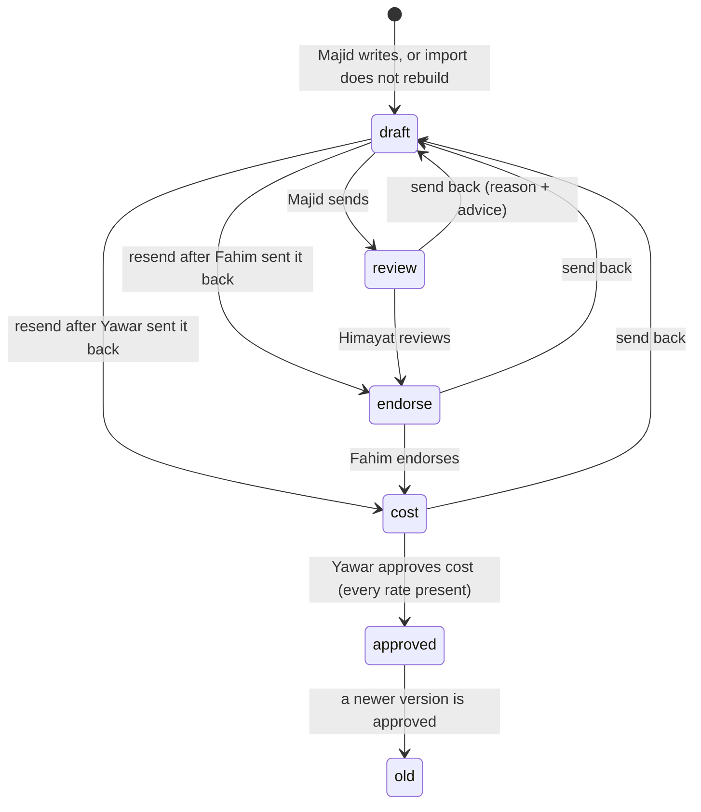
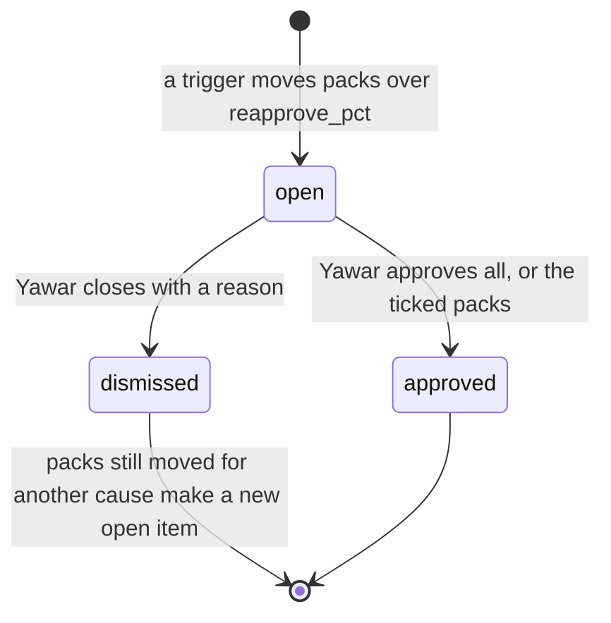
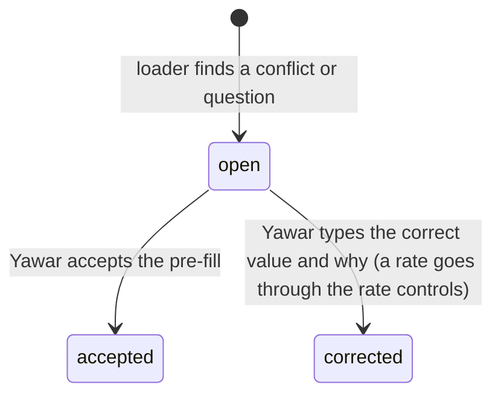
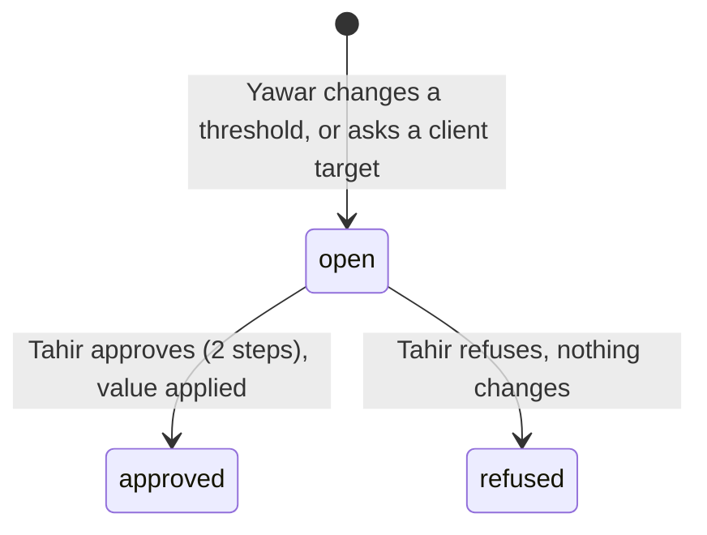

# 3. System logic

Version 1.0.0 · 19 Oct 2026 · Owner: Yawar; Tahir approves changes · Rule: R-5h item 3 (D-20)
Changed in 1.0.0 (19 Oct 2026): 3.18 added: buyer lines, targets, the client price state, the VAN brand price grid, Margin and its red rule (D-74 to D-79); 3.17 says a revision can add a row.
Changed in 0.9.3 (19 Oct 2026): 3.17 added: the VAN brand list margin (D-70, D-72, D-73).
Changed in 0.9.1 (3 independent reviews, 18 Oct 2026 night): 3.16 added (D-60 to D-65).
Changed in 0.9.1 (documentation review, 18 Oct 2026): 3.3 when "replaced" is written; 3.4 Tahir sees re-approvals under Waiting on others; 3.10 where "Not costed" shows; 3.12 a wrong mount answers 503; 3.13 stuck marks on every waiting line (D-54); 3.15 the full priority list and what Waiting on others holds; owners on 3.2 and 3.13.
Changed in 0.9.0: new 3.15 how Today orders the work and counts age (D-54).
Changed in 0.7.0: new 3.14 matching an O2S line to a pack, and VAN brand sales (D-44).
Changed in 0.6.0: 3.4 re-approval figures and the check on approval (D-41); 3.10 when a pack is costed (D-40) and the base of a rate save.
Changed in 0.4.0 and 0.5.0: price and list revision states with waiting, cancelled and withdrawn; rate choice has 4 levels (base bands last) and the tie-break is more conditions first; flag wording; mount needs the pool, dates as text, prepared statements; stuck flag built.
Changed in 0.3.0 and 0.3.1: the 409 message replaces "Already decided". New state diagrams: re-approval, list revision, import item, setting request, target request. New decision tables: labour and FOH rate choice, nutrient_role. Price proposal states drawn.

Rule references as in 01.

## 3.1 Recipe version states (owner: Majid to Yawar; D-08, D-09, R-5i 1)



## 3.2 Decision table: who acts at each recipe step (owner: Majid to Yawar; D-08)

| State | Who acts | Can send back | Next | Refused when |
|---|---|---|---|---|
| draft | production (Majid) | no | review, or the step that sent it back | no lines |
| review | qc (Himayat) | yes | endorse | not his step |
| endorse | plant (Fahim) | yes | cost | not his step |
| cost | cfo (Yawar) | yes | approved | a material has no rate; a pack has no labour or no FOH rate (0.3.1) |

## 3.3 Price proposal states (owner: Yawar and Tahir; D-22, R-5i 3)

```mermaid
stateDiagram-v2
  [*] --> proposed: Yawar proposes (1 open per pack), with Takes effect from
  proposed --> in_force: Tahir approves, dated today or earlier; prev price taken now
  proposed --> waiting: Tahir approves, dated ahead (status approved, valid_from after today)
  proposed --> sent_back: Tahir sends back with reason
  sent_back --> replaced: Yawar revises and resends (new proposal)
  waiting --> in_force: its date comes (picked by date, nothing is written)
  in_force --> replaced: a newer price takes over, valid_to = the day before it starts
  waiting --> withdrawn: Tahir withdraws it; the shortened price gets its old end back
  waiting --> cancelled: a newer approval for the pack; the shortened price gets its old end back
```


"in_force" and "waiting" are both status approved; the date decides. Status "replaced" is written only when the new price starts on the day it is approved; a price ended by a price dated ahead keeps status approved, with valid_to set to the day before the new one starts. Only 1 price may wait for its date per pack. When a waiting price is cancelled or withdrawn, the price in force loses the end date it was given, so it stays in force.

## 3.4 Re-approval item states (owner: Yawar; R-2 Cost, R-5i 6)


Tahir sees open items under "Waiting on others" on his Today (with Yawar, re-approve, with their age; not counted as jobs); Open shows the packs read only (0.9.0, D-54). He cannot approve or close them (403).
Each pack in an item shows from = its last approved cost, to = its cost after the change, and % against the approved cost (D-41, 0.6.0). On approval C2M recosts each pack today and checks it again: a pack now within reapprove_pct of its approved cost, or no longer fully costed, keeps its approved cost; the reply lists it under "left" and the change record says "left: within threshold" or "left: not costed". A costed pack with no approved cost yet joins an item made by any other trigger (e.g. a packing bill assigned) as "first cost" (from blank); approving it sets its first approved cost without the % check.

## 3.5 VAN list revision states (owner: Yawar and Tahir; D-28)

```mermaid
stateDiagram-v2
  [*] --> proposed: Yawar proposes (1 open per list; refused while an approved revision of the list waits)
  proposed --> applied: Tahir approves, dated today or earlier (status approved, applied 1); list rows and dates change
  proposed --> waiting: Tahir approves, dated ahead (status approved, applied 0)
  proposed --> sent_back: Tahir sends back with reason
  sent_back --> replaced: Yawar revises and resends (new revision)
  waiting --> applied: first load of C2M on or after its date (applyDueRevisions; audit "applied", once)
  waiting --> withdrawn: Tahir withdraws with why (audit "withdrawn"); Yawar gets a notice
  applied --> [*]
```

## 3.6 Import item states (owner: Yawar; D-07)



## 3.7 Setting request and target request states (owner: Yawar proposes, Tahir decides; D-18, D-06)


Budget and ambition lines (needs_approval = 0) apply at once with a notice to Tahir; no request is made.

## 3.8 Decision table: labour and FOH rate choice (owner: Yawar; D-25, R-5i 7; code c2m-lib.js pickConversionRule)

Run once for labour and once for FOH. Only active rates with valid_from today or earlier count. Every level also checks the rate's form, reprocessed and pack range against the product (formOk and inPack; list rates too, from 0.3.1). First level with a match wins (D-37).

| Level | Rate qualifies when | Example |
|---|---|---|
| 1 | The product is on the rate's list (c2m_conversion_rule_product, or the old scope_client_product_id) | "Liquid filling labour" ticked for 2 products |
| 2 | Not a list rate, and scope_base_product_id = the product's type | FOH for a product type such as "Product type T" |
| 3 | Not a list rate, no product type, is_base = 0: a rate Yawar added for all products | "Labour, all liquids" |
| 4 | Not a list rate, no product type, is_base = 1: the base bands | The base bands (Rs per kg, set by Yawar; loaded at first load) |

So any rate Yawar adds beats the base bands for the products it covers.

| Tie-break inside a level, in order | Wins |
|---|---|
| 1. Number of conditions (form, reprocessed, pack min, pack max) | more conditions |
| 2. valid_from | the latest date |
| 3. Pack range width (max less min) | the narrower range |
| 4. id | the newest |

Pack range: from scope_pack_min (included) to below scope_pack_max. No rate found for a kind: that kind is 0, and cost approval and rate retire are refused for that pack (0.3.1).

## 3.9 Decision table: nutrient_role (owner: Himayat; D-23, R-5i 4a; code c2m-engine.js nutrients)

| nutrient_role | Fields asked | In recipe weight and cost | Adds to analysis | Shown to Himayat as | Analysis complete? |
|---|---|---|---|---|---|
| nutrient | the class's fields, e.g. K% | yes | qty x % per field | "to enter: field" until every field has a value, then "complete" | only when every field has a value |
| none | none | yes | 0; listed as a non-nutrient input with its kg | "adds no nutrients" (never "to enter") | yes |
| unclassified | none | yes | nothing; listed as "to classify" | "to classify" | no |

Saving a class with role none or unclassified clears the grade's nutrient values; the old values stay in c2m_audit.

## 3.10 Rate save (owner: Yawar; D-10)
Warning when abs(new - last) / last > rate_warn_pct (rise or drop). Refused without a source. Refused above the warning without "Yes, I meant this rate". Digits only. After save: 1 re-approval item for the packs that moved more than reapprove_pct from their approved cost (D-41); a material's first rate batches packs the same way. A pack with no approved cost yet is not batched by a rate save; a pack of an inactive product is skipped (0.6.0).
Costed (D-40): a pack shows a cost only when every material has a rate; a VAN-packed pack has a packing bill with at least 1 item, every item priced above Rs 0, and a pack size above 0 (bulk, and client-packed with no bill: packing 0); and a labour and a FOH rate apply. A rate of Rs 0 (material, labour or FOH) counts as missing. Otherwise the product page (Cost and price by pack) and Recipes show "Not costed" with what is missing, Yawar's Today lists the pack when its recipe is approved, no price can be proposed for it (also when its recipe is not in C2M yet, D-40), and cost approval is refused naming the pack (checked before and again inside the transaction).

## 3.11 Flags (owner: Tahir; D-17, R-5f)
Below cost: red. Below target by more than red_gap_pts AND Rs gap above red_share_pct % of all white label sales in the period: red (D-31). More than red_gap_pts below target but a small Rs gap: amber "N pts below target, small Rs". Within red_gap_pts of target: amber "slightly below target". Below budget: amber. Else green. No target and no budget: grey "no target", never green. A missing target stays blank, never 0.

## 3.12 Two people saving at once (owner: Tahir; 0.2.0, 0.3.1 and 0.5.0)
C2M needs the platform's mysql2 promise pool, because transactions and the guards below depend on it. Without it (or without pdq and auth), every /c2m and /api/c2m request gets 503 "C2M is not set up: ... Ask IT." and the platform keeps running (0.5.0 second review round). A startup check reads a date from the database; if the pool does not return dates as text (mysql2 option dateStrings: true), every /api/c2m request gets 503 "C2M needs the database pool to return dates as text ... Ask IT." Every query runs as a prepared statement (pool.execute); a list in a query gets 1 placeholder per value (IN (?,?,?)).
Each action is 1 request inside 1 transaction. It locks the row it changes (SELECT ... FOR UPDATE) and updates only if the row is still in the expected state (e.g. a recipe still at the caller's step; a price still "proposed"; a re-approval still "open"). If someone else changed it first, nothing changes and the person gets 409:
"Someone else changed this a moment ago. Check before retrying."
Routes that can return it are listed in 05, section 5.3. The O2S pull has its own 409: "A pull is already running. Wait a minute, then look again." The pull lock frees itself after 10 minutes.
One exception: sending back a price that is no longer proposed gives 400 "Nothing to send back."

## 3.13 Lateness, escalation, hand over, stand in, away (owner: Tahir; D-33, D-54)
Built (0.4.0, D-33): a recipe more than 2 working days at 1 step (Sundays off) shows on Tahir's Today as "Recipe stuck N working days". No message leaves C2M.
Built (0.9.0, D-54): every waiting line on every person's Today shows its age in days and is marked "stuck" after more than 2 working days, Monday to Saturday (see 3.15).
Not built (not ruled): escalation, due dates, hand over, stand in and away. Nobody stands in for another role. Recorded as open issue I-01 in 12.

## 3.14 Matching an O2S line to a pack (owner: Yawar; D-44; code c2m-engine.js matcher)

| O2S line | C2M pack | Sale shows |
|---|---|---|
| White Label channel | The client's own product (customer name in o2s_names, brand, pack) | The client |
| Any other channel, a customer's own product exists | That product (kept for old data) | That customer |
| Any other channel | The VAN brand pack with that brand (or another O2S spelling in o2s_brand) and pack size | The O2S buyer, its channel (COBO, VGreen, Dealer, Distributor, Farmer) and region |
| No pack found | None: the sale counts in sales with no cost and is listed under "Sales C2M could not place" | The O2S buyer |

A VAN brand pack shows no single price (each channel has its own list); a per-pack price proposal for it is refused. Freight is not added to VAN brand costs (none is loaded); freight by the sale's channel and region is not built (I-25).

## 3.15 How Today orders the work and counts age (owner: Tahir; D-54, B-12; code c2m.html jobs(), nextMove(), waitingOn())
Each job knows its group (approve, do, or red), its priority and the date it started waiting: the last recipe step, the proposal date, the re-approval date, the date the sheets were loaded, or the 1st of the month for monthly entries. The next move is the first approval by priority (recipe and cost steps 1, prices 2, re-approvals and list revisions 3, thresholds and targets 5), oldest first; else the first red item by priority, oldest first; else the first job by priority, oldest first. Jobs with no start date sort after dated ones.

| Priority | Yawar (cfo) | Tahir (coo) | Majid, Himayat, Fahim |
|---|---|---|---|
| 1 | recipe at the cost step (approve) | | recipe at their step (approve; Majid's draft is a do) |
| 2 | price sent back, list revision sent back (do) | approve price | |
| 3 | re-approval (approve); client prices to change (do) | approve list revision | |
| 4 | packs costed with no price (red) | recipe stuck (red) | |
| 5 | packs not costed (do) | approve threshold change, approve target | Himayat: materials to complete (do) |
| 6 | items from Yawar's sheets (do) | customers flagged red (red) | |
| 7 | monthly actuals, tie to the books (do) | monthly rate check (do) | |

Age is in calendar days; stuck is more than 2 working days, Monday to Saturday. Waiting on others lists items with someone else: for every recipe role, recipes at another person's step; for Yawar, his prices, list revisions, threshold and target requests waiting for Tahir; for Tahir, the re-approvals waiting for Yawar (a stuck recipe shows as his job instead). The rail's number is the count of jobs.

## 3.16 Logic added in 0.9.1 (owner: Yawar for cost and prices, Tahir for controls; version 0.9.1, 18 Oct 2026)

| When | C2M does | Rule |
|---|---|---|
| A pull reads a shipment with no approvedDate (still loading) | Leaves it out; it becomes a truck on the first pull after its gate pass | D-60, ruling 14 |
| Yawar approves only the ticked packs of a re-approval item | Approves those; puts the others still beyond reapprove_pct (or with no approved cost) in a new open item "Left open from item N" | D-61 |
| An FOC line (price 0) has trucks or open kg | Keeps them out of sales, GP, open POs and Rs at stake; lists the trucks on their own with their cost | D-62, ruling 14b |
| An approved price passes its last day and no other is in force | The pack has no price; it shows as costed with no price ("price ended") until a new price is approved | D-62, ruling 3 |
| A price is approved for a later date | Rs at stake counts the current gap until that date and the gap at the new price after it | D-62 |
| Someone approves a price, list revision, setting or target they proposed | Refused (403); refusing your own request is allowed | D-63, ruling 19 |
| Yawar adds or retires a labour or FOH rate, changes a packing bill or gives one to a pack, or changes a product type or the reprocessed tick | Saves it, raises any re-approval, and puts a notice on Tahir's Today with the packs moved | D-63, ruling 12 |
| Tahir saves the rate check, or Yawar the tie to the books | Refused until every register rate, or both ERP figures, are entered | D-64 |
| On a screen, a product type, reprocessed or packing bill change is picked | Nothing is saved until Save; Cancel drops it | D-65 |
| C2M holds no product yet (before the first load) | Today, Margin, Products, Prices and Inputs say what is missing and where it comes from; monthly jobs wait | D-65 |

## 3.17 VAN brand list margin (owner: Yawar for the links and figures, Tahir rules; D-70, D-72, D-73; version 0.9.3, 19 Oct 2026; code c2m.html vanMargin(), c2m-routes.js /lists/links)
- Each VAN brand list row (distributor, dealer, farmer) carries the C2M pack it is, as packId inside the row's data. Yawar links it once in Reports, VAN brand list margin; C2M suggests a pack only where the row's name, with its size taken out, is the same as the VAN product's name and the size and unit (kg or L) are the same, and marks it "suggested: check"; every other row starts "Not linked". Save sends every row whose pick differs from what is stored, shown or not, suggestions included, and the button counts them. A row linked to a pack that is no longer an active VAN brand pack says so ("Pack no longer active") and stays out of the table until Yawar picks again or unlinks it. A row is never linked by name in the report itself, and never through O2S (D-71).
- A revision of a list changes prices, so the link stays. From 1.0.0 a revision can also add a row for a VAN pack not on that list, carrying its pack from the start (D-77, 3.18).
- 1 line per linked VAN pack: its cost today per pack (cost per kg or L x pack size), and on each list the price without FED and its GP (F-22). Cost per pack is before freight (cost total less freight). If 2 or more rows of 1 list are linked to the same pack, the first with a price is used and the line says how many rows.
- State, from the worst GP on the lists shown (distributor, dealer, the farmer list picked): not costed; no list price; below cost (red); below ambition (amber, more than 0.05 points under the ambition GP); at or above ambition (green). With no ambition GP set, only below cost is judged. Lines are listed worst first: by state, then by the lowest GP on the lists shown.
- The answer line: the VAN brand portfolio GP on trucks this FY (approved cost on each truck's date, as Margin) against the ambition GP, then how many packs are below ambition on at least 1 list, and names the worst: the pack below cost and its list, or the pack furthest below ambition. With no ambition GP set, it counts the packs below cost. With no VAN brand truck read from O2S, it says so and the table still works.
- Rows not linked are counted and listed under the table; Yawar can show all rows to change a link. Tahir reads the links and cannot change them.

## 3.18 Logic added in 1.0.0 (owner: Yawar for prices and figures, Tahir rules; D-74 to D-79; version 1.0.0, 19 Oct 2026; code c2m-lib buyerLine, targetOr; c2m-routes /lists/revise, applyRevision; c2m.html vMargin2, vPrices2, ncpVan, vSetup2)

Buyer line (D-74), decision table, read on every PO line, truck, FOC truck and open PO:

| O2S on the PO | Category | Line shown in C2M |
|---|---|---|
| group White label (any channel) | White label | the client's name |
| channel Distributor | Distributors | the distributor's name |
| channel Dealer | Dealers | the dealer's name |
| channel COBO | COBO | "COBO" (1 line) |
| channel VGreen | VGreen | "VGreen" (1 line) |
| any other channel, or none (farmers and others) | Farmers and other | "Farmers and other" (1 line, never named, no region) |

Target (D-75): a product's own GP target if set, else the company GP target (setting budget_gp). Used by Margin, Client prices, the VAN brand grid and the price proposal check. A target of 0 is a target.

Client price state (D-78): not costed (no cost today); below (no price, or GP more than 0.05 points under target); "above: check" (GP more than 5 points over target); on target (the rest). The 5 points is a constant in the page (ABOVE_PTS), to confirm (I-39).

VAN brand price grid (D-77): each cell is the row of that list linked to the pack (saved packId), else a row suggested by the B-18 rule (marked "suggested"), else empty. A typed value equal to the cell's value is not a change. On Send, cells of an existing row become changes to that row; cells with no row become 1 added item per pack and list. The server refuses an added item for a pack that is not a VAN brand pack, a pack already linked on that list, a price not above 0, or while any row of that list has no pack linked (400, nothing saved): a row the list holds under another name could otherwise be entered twice. The grid closes the empty cells of such a list and says how many rows to link. A pack waiting to be added cannot be linked to a row of that list (POST /lists/links, 400); at apply time, if a row of the list is linked to the pack after all, that row takes the prices. An added distributor row is written as never sent (no previous price, D-42). A link that would put a 2nd row of a list on 1 pack is refused (D-77); a pair made before is marked "n rows on this list", listed, and blocks adds to that list until corrected. A list whose revision is with Tahir, or approved and waiting for its date, is closed in the grid with the reason, and an approved price waiting for its date shows in its cell with the date. Suggestions that would put 2 rows on 1 pack are not offered. A send from Client prices replaces every sent-back proposal of that pack (keeping a sent-back valid-till date), and a sent-back price shows on its row; and a send from the grid replaces the latest sent-back revision of that list (replaceId). A sent-back revision opens in its panel from the grid; its added rows show as "new row on this list" and can be revised and resent. On approval the row is written: for the farmer list the size goes into the product name ("Brand 25 kg") as the farmer list prints it; the other lists keep a pack column; FED and dealer net are worked out as for any row.

Margin (D-79): rows = trucks with an approved cost on their date (or, restated, a cost today). Group by buyer line, base product line (product type for white label, brand for VAN), or buyer line x pack. Each group's sums by F-23. State: red = below cost, or more than red_gap_pts short of target and Rs short above red_share_pct % of all white label sales in the period; amber = any other short; green = on or above. Sorted by Rs against target, then sales. The Approvals red item counts white label buyer lines red by the same rule, FY to date, at the cost approved on each truck's date.

Places (D-76): ROLES gives cfo and coo nav [approvals, products, prices, margin, setup] and more [reports, inputs, backoffice, guide]. On a phone the first 4 sit in the bottom bar; the 5th and the More places are in the More sheet. On a wide screen the More sheet shows only the More places.
