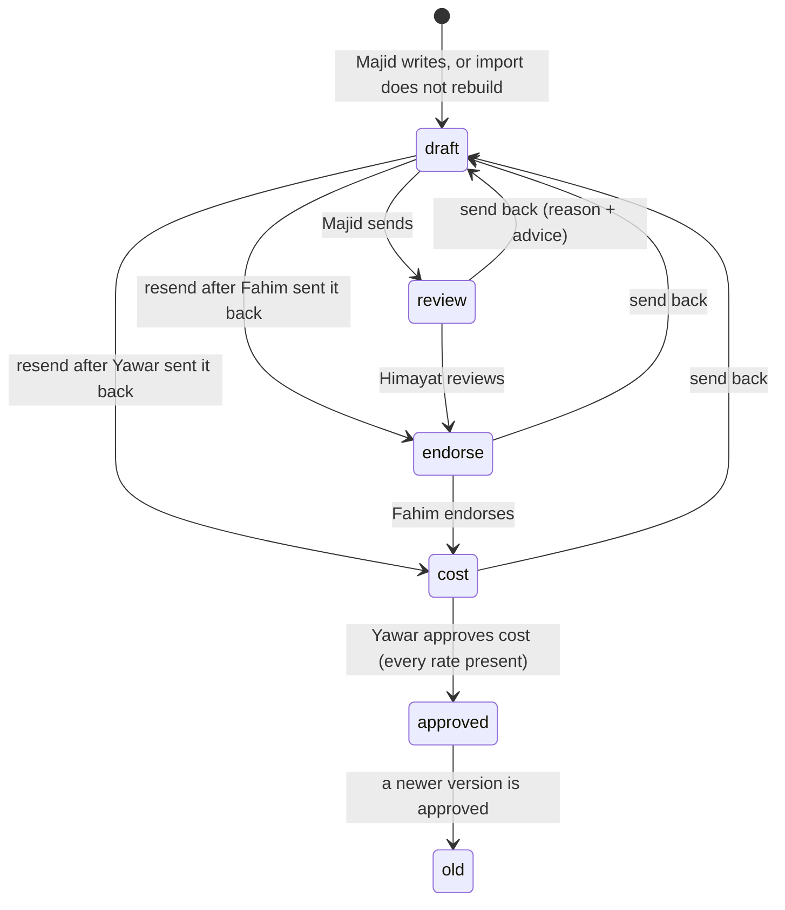
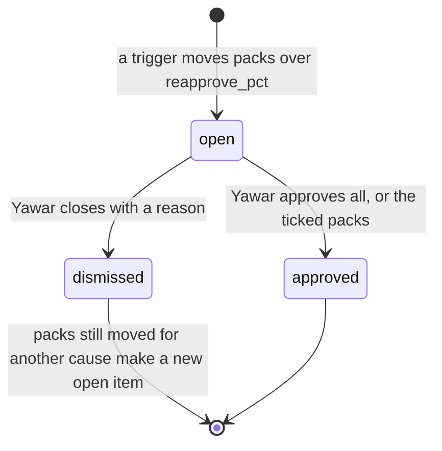
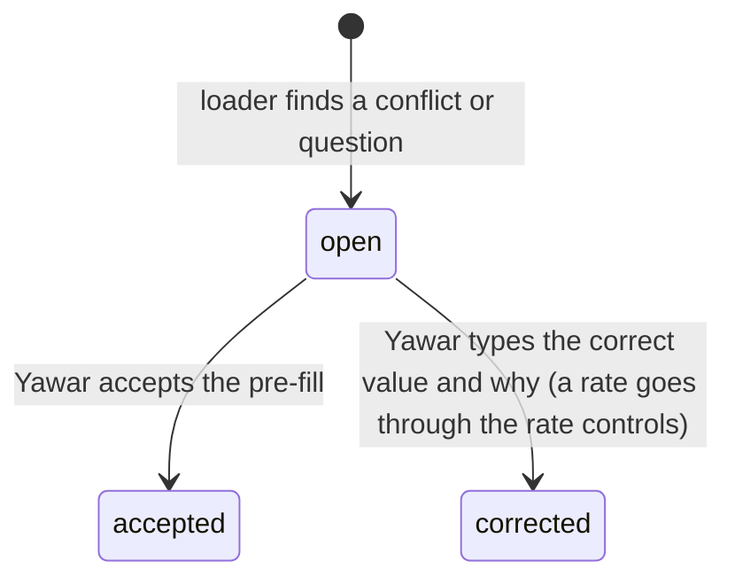
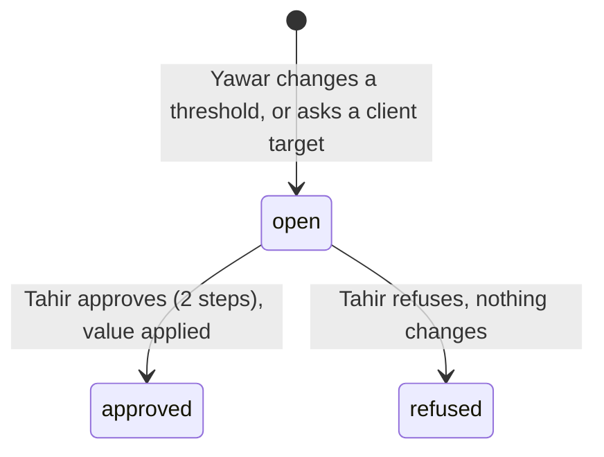

# 3. System logic

Version 1.2 · 16 Oct 2026 · Owner: Yawar; Tahir approves changes · Rule: R-5h item 3 (D-20)
Changed in 0.4.0 and 0.5.0: price and list revision states with waiting, cancelled and withdrawn; rate choice has 4 levels (base bands last) and the tie-break is more conditions first; flag wording; mount needs the pool, dates as text, prepared statements; stuck flag built.
Changed in 0.3.0 and 0.3.1: the 409 message replaces "Already decided". New state diagrams: re-approval, list revision, import item, setting request, target request. New decision tables: labour and FOH rate choice, nutrient_role. Price proposal states drawn.

Rule references as in 01.

## 3.1 Recipe version states (owner: Majid to Yawar; D-08, D-09, R-5i 1)



## 3.2 Decision table: who acts at each recipe step (D-08)

| State | Who acts | Can send back | Next | Refused when |
|---|---|---|---|---|
| draft | production (Majid) | no | review, or the step that sent it back | no lines |
| review | qc (Himayat) | yes | endorse | not his step |
| endorse | plant (Fahim) | yes | cost | not his step |
| cost | cfo (Yawar) | yes | approved | a material has no rate; a pack has no labour or no FOH rate (0.3.1) |

## 3.3 Price proposal states (owner: Yawar and Tahir; D-22, R-5i 3)

```mermaid
stateDiagram-v2
  [*] --> proposed: Yawar proposes (1 open per pack), with Takes effect from
  proposed --> in_force: Tahir approves, dated today or earlier; prev price taken now
  proposed --> waiting: Tahir approves, dated ahead (status approved, valid_from after today)
  proposed --> sent_back: Tahir sends back with reason
  sent_back --> replaced: Yawar revises and resends (new proposal)
  waiting --> in_force: its date comes (picked by date, nothing is written)
  in_force --> replaced: a newer price takes over, valid_to = the day before it starts
  waiting --> withdrawn: Tahir withdraws it; the shortened price gets its old end back
  waiting --> cancelled: a newer approval for the pack; the shortened price gets its old end back
```


"in_force" and "waiting" are both status approved; the date decides. Only 1 price may wait for its date per pack. When a waiting price is cancelled or withdrawn, the price in force loses the end date it was given, so it stays in force.

## 3.4 Re-approval item states (owner: Yawar; R-2 Cost, R-5i 6)


Tahir sees open items under "For your information" on his Today (not counted as jobs) and read only on Recipes; he cannot approve or close them (403).

## 3.5 VAN list revision states (owner: Yawar and Tahir; D-28)

```mermaid
stateDiagram-v2
  [*] --> proposed: Yawar proposes (1 open per list; refused while an approved revision of the list waits)
  proposed --> applied: Tahir approves, dated today or earlier (status approved, applied 1); list rows and dates change
  proposed --> waiting: Tahir approves, dated ahead (status approved, applied 0)
  proposed --> sent_back: Tahir sends back with reason
  sent_back --> replaced: Yawar revises and resends (new revision)
  waiting --> applied: first load of C2M on or after its date (applyDueRevisions; audit "applied", once)
  waiting --> withdrawn: Tahir withdraws with why (audit "withdrawn"); Yawar gets a notice
  applied --> [*]
```

## 3.6 Import item states (owner: Yawar; D-07)



## 3.7 Setting request and target request states (owner: Yawar proposes, Tahir decides; D-18, D-06)


Budget and ambition lines (needs_approval = 0) apply at once with a notice to Tahir; no request is made.

## 3.8 Decision table: labour and FOH rate choice (owner: Yawar; D-25, R-5i 7; code c2m-lib.js pickConversionRule)

Run once for labour and once for FOH. Only active rates with valid_from today or earlier count. Every level also checks the rate's form, reprocessed and pack range against the product (formOk and inPack; list rates too, from 0.3.1). First level with a match wins (D-37).

| Level | Rate qualifies when | Example |
|---|---|---|
| 1 | The product is on the rate's list (c2m_conversion_rule_product, or the old scope_client_product_id) | "Liquid filling labour" ticked for 2 products |
| 2 | Not a list rate, and scope_base_product_id = the product's type | FOH for a product type such as "Product type T" |
| 3 | Not a list rate, no product type, is_base = 0: a rate Yawar added for all products | "Labour, all liquids" |
| 4 | Not a list rate, no product type, is_base = 1: the base bands | The base bands (Rs per kg, set by Yawar; loaded at first load) |

So any rate Yawar adds beats the base bands for the products it covers.

| Tie-break inside a level, in order | Wins |
|---|---|
| 1. Number of conditions (form, reprocessed, pack min, pack max) | more conditions |
| 2. valid_from | the latest date |
| 3. Pack range width (max less min) | the narrower range |
| 4. id | the newest |

Pack range: from scope_pack_min (included) to below scope_pack_max. No rate found for a kind: that kind is 0, and cost approval and rate retire are refused for that pack (0.3.1).

## 3.9 Decision table: nutrient_role (owner: Himayat; D-23, R-5i 4a; code c2m-engine.js nutrients)

| nutrient_role | Fields asked | In recipe weight and cost | Adds to analysis | Shown to Himayat as | Analysis complete? |
|---|---|---|---|---|---|
| nutrient | the class's fields, e.g. K% | yes | qty x % per field | "to enter: field" until every field has a value, then "complete" | only when every field has a value |
| none | none | yes | 0; listed as a non-nutrient input with its kg | "adds no nutrients" (never "to enter") | yes |
| unclassified | none | yes | nothing; listed as "to classify" | "to classify" | no |

Saving a class with role none or unclassified clears the grade's nutrient values; the old values stay in c2m_audit.

## 3.10 Rate save (owner: Yawar; D-10)
Warning when abs(new - last) / last > rate_warn_pct (rise or drop). Refused without a source. Refused above the warning without "Yes, I meant this rate". Digits only. After save: 1 re-approval item for the packs that moved more than reapprove_pct.

## 3.11 Flags (owner: Tahir; D-17, R-5f)
Below cost: red. Below target by more than red_gap_pts AND Rs gap above red_share_pct % of all white label sales in the period: red (D-31). More than red_gap_pts below target but a small Rs gap: amber "N pts below target, small Rs". Within red_gap_pts of target: amber "slightly below target". Below budget: amber. Else green. No target and no budget: grey "no target", never green. A missing target stays blank, never 0.

## 3.12 Two people saving at once (owner: Tahir; 0.2.0, 0.3.1 and 0.5.0)
C2M needs the platform's mysql2 promise pool: c2m-routes refuses to start without it, because transactions and the guards below depend on it. A startup check reads a date from the database; if the pool does not return dates as text (mysql2 option dateStrings: true), every /api/c2m request gets 503 "C2M needs the database pool to return dates as text ... Ask IT." Every query runs as a prepared statement (pool.execute); a list in a query gets 1 placeholder per value (IN (?,?,?)).
Each action is 1 request inside 1 transaction. It locks the row it changes (SELECT ... FOR UPDATE) and updates only if the row is still in the expected state (e.g. a recipe still at the caller's step; a price still "proposed"; a re-approval still "open"). If someone else changed it first, nothing changes and the person gets 409:
"Someone else changed this a moment ago. Check before retrying."
Routes that can return it are listed in 05, section 5.3. The O2S pull has its own 409: "A pull is already running. Wait a minute, then look again." The pull lock frees itself after 10 minutes.
One exception: sending back a price that is no longer proposed gives 400 "Nothing to send back."

## 3.13 Lateness, escalation, hand over, stand in, away
Built (0.4.0, D-33): a recipe more than 2 working days at one step (Sundays off) shows on Tahir's Today as "Recipe stuck N working days". No message leaves C2M.
Not built (not ruled): escalation, due dates, hand over, stand in and away. Nobody stands in for another role. Recorded as open issue I-01 in 12.
