# 4. Database schemas

Version 1.0.3 · 20 Oct 2026 · Owner: Tahir (C2M module owner); Claude records · Rule: R-5h item 4 (D-20)
Changed in piece 3 (21 Oct 2026; D-94, D-95, D-98): 4.11 added: 5 new tables (migration 003_c2m_variants_clients.sql and its PRODUCTION version): 45 tables; no existing table or column changed. Changed in the next version (21 Oct 2026; piece 1 of 4 after Tahir's rulings D-89 to D-95; the version number is set at the push; 1.0.3 is live): 4.10 added: new table c2m_role (migration 002_c2m_roles.sql and its PRODUCTION version): 40 tables. No other table or column changed.
Changed in 1.0.3 (20 Oct 2026; 1.0.2 went live on 20 Oct at 11:24): after review, D-88 (take off a list, the description, rows leaving chosen). no table, column or migration. c2m_list_price.list_name may also hold dist_old, dealer_old, farmer_old (rows not carried into the master, read only); data_json.left {at, by, why} on those rows; c2m_audit entity list_master, action carried is the flag of the carry-over (D-87).
Changed in 1.0.2 (19 to 20 Oct 2026; 1.0.1 went live on its own on 19 Oct at 23:19): no table, column or migration. c2m_client_product.brand (the official name) and o2s_brand (O2S spellings) are edited from Setup, Product names; c2m_list_price.data_json may hold listName, listP and listPack (the name a row had before it was renamed); a renamed row updates the columns product and pack too (D-85). 20 Oct 2026: the unique key uq_cp (customer_id, channel, o2s_brand) answers a clear 400 when 2 VAN brand products would have exactly the same spellings; 2 VAN brand products may share brand when their pack sizes differ (no key on brand); the second of 2 products with exactly the same spellings is stored with a leading | (an empty spelling, ignored everywhere). c2m_client_product.active is set from Setup, Product names (Take out of use, Put back in use, D-86).
Changed in 1.0.1 (19 Oct 2026): no table, column or migration. c2m_list_price.data_json may hold noPack, noPackBy and noPackAt (D-80).
Changed in 1.0.0 (19 Oct 2026): no table, column or migration. c2m_list_price can get rows from an approved revision (D-77); c2m_list_revision.items_json items may be added rows; setting wl_budget_gp kept but no longer used (D-75).
Changed in 0.9.3 (19 Oct 2026): c2m_list_price.data_json may hold packId (D-73); no table, column or migration.
Changed in 0.9.2 (19 Oct 2026): no table or column; the first load adds 1 setting row, fed_pct (D-72); "sales tax" taken out of the meaning of net_price and price (FED is the only tax on VAN). The migration's own comments still say "FED and sales tax" (001 is frozen).
Changed in 0.9.1 (documentation review, 18 Oct 2026): 001 is live and frozen (run on live 17 Oct); PRODUCTION header lines; reprocessed is set on the product page; full lists of audit actions and entities. No table or column changed by this review.
Changed in 0.9.0: no change: 0.9.0 adds no table, column or migration (D-58).
Changed in 0.8.0: no table change; place names only (D-45 to D-52).
Changed in 0.7.0: no table change; c2m_client_product.channel takes "VAN brand" (D-44); o2s_brand may hold other spellings separated by |; 1 owner row in c2m_customer, "VAN brand (all channels)".
Changed in 0.4.0 and 0.5.0: new columns c2m_conversion_rule.is_base and c2m_list_revision.applied; settings are 9 rows (red_share_pct replaces red_rs; new conv_budget_month; budget_gp, ambition_gp, wl_budget_gp and conv_budget_month start at 0 and are set by the first load); new audit actions cancelled, withdrawn, applied, cost moved since shown; examples use made-up figures. Still 39 tables.
Changed in 0.3.0 and 0.3.1: 39 tables (was 37). New tables c2m_conversion_rule_product and c2m_list_revision. New columns c2m_material_type.nutrient_role, c2m_conversion_rule.kind, c2m_client_product.budget_kg_year. Full column dictionary, keys and indexes added. Full ER diagram.

Source of truth: `apps/c2m/migrations/001_c2m_core.sql`. Every table is named `c2m_...`. Engine InnoDB, utf8mb4, ROW_FORMAT=DYNAMIC. Target MySQL 5.7+ or MariaDB 10.4+.
Rule references: R-2 = Design Record section 2; R-5b to R-5i = Design Record sections 5b to 5i; D-xx = 06-decisions.md.

## 4.1 Migrations, in order

| File | What it does | Applied | Owner | Rule |
|---|---|---|---|---|
| 001_c2m_core.sql | Creates 39 c2m_ tables, 9 default settings (see c2m_setting below) and 4 data sources. CREATE TABLE IF NOT EXISTS and INSERT IGNORE: safe to run twice. Changes no O2S, PD or platform table. | Local, from the C2M App folder: `npm run migrate` (c2m_dev) and `npm test` (c2m_test) | Tahir | D-21 |
| 001_c2m_core.PRODUCTION.sql | The same content as 001_c2m_core.sql, with 4 lines in front (3 comment lines and the USE line that names the platform database; phpMyAdmin needs it). Keep both in step; the test run checks it (migration.sync) | Run on live by Tahir in phpMyAdmin on 17 Oct 2026: 39 empty c2m_ tables (C2M Go Live Plan.md) | Tahir | D-21 |

001 ran on live on 17 Oct 2026 and is now frozen. Every table change from now on is a new file 002_... plus its 002_....PRODUCTION.sql, and must not edit 001. Whether a comment-only edit to 001 (both files, no schema change) is allowed is for Tahir to confirm (A-21 in 12).

Check after running: `SELECT COUNT(*) FROM information_schema.tables WHERE table_schema = DATABASE() AND table_name LIKE 'c2m\_%';` gives 39.

## 4.2 Entity relationships (crow's foot, all 39 tables)

Notes: C2M declares no FOREIGN KEY constraints (the platform does not use them). The links below are kept by the code. Tables with no line to another table stand alone.

```mermaid
erDiagram
  c2m_source ||--o{ c2m_field_map : "maps fields"
  c2m_sync_run ||--o{ c2m_o2s_po_line : "sync_id"
  c2m_sync_run ||--o{ c2m_o2s_truck : "sync_id"
  c2m_o2s_po_line ||--o{ c2m_o2s_truck : "line_id"
  c2m_customer ||--o{ c2m_client_product : buys
  c2m_base_product ||--o{ c2m_variant : "has variants"
  c2m_base_product ||--o{ c2m_client_product : "product type"
  c2m_variant |o--o{ c2m_client_product : variant
  c2m_client_product ||--|{ c2m_client_pack : "sold in"
  c2m_client_product ||--o{ c2m_recipe_version : "own recipe, every version"
  c2m_client_product ||--o{ c2m_target_request : "target override"
  c2m_client_product ||--o{ c2m_conversion_rule_product : "listed on rate"
  c2m_conversion_rule ||--o{ c2m_conversion_rule_product : "list of products"
  c2m_base_product |o--o{ c2m_conversion_rule : "rate for a type"
  c2m_recipe_version ||--|{ c2m_recipe_line : inputs
  c2m_recipe_version ||--|{ c2m_recipe_step : history
  c2m_material_type |o--o{ c2m_raw_material : "class and nutrient fields"
  c2m_raw_material ||--|{ c2m_material_grade : grades
  c2m_material_grade ||--|{ c2m_material_rate : "dated rates"
  c2m_material_grade ||--o{ c2m_recipe_line : "used in"
  c2m_packing_item ||--|{ c2m_packing_rate : "price per piece, dated"
  c2m_packing_item ||--o{ c2m_packing_bill_line : "used in"
  c2m_packing_bill ||--|{ c2m_packing_bill_line : items
  c2m_packing_bill |o--o{ c2m_client_pack : "packed with"
  c2m_client_pack ||--o{ c2m_cost_version : "dated approved cost"
  c2m_recipe_version |o--o{ c2m_cost_version : "costed from"
  c2m_client_pack ||--o{ c2m_price : prices
  c2m_list_price ||--o{ c2m_list_revision : "rows in items_json"
  c2m_customer ||--o{ c2m_list_grant : "client grant by name"
  c2m_setting ||--o{ c2m_setting_request : "changes_json keys"
  c2m_client_pack ||--o{ c2m_reapproval : "packs in items_json"
  c2m_price_doc {
    int id PK
  }
  c2m_freight_rate {
    int id PK
  }
  c2m_monthly_actual {
    char month PK
  }
  c2m_monthly_check {
    int id PK
  }
  c2m_notice {
    int id PK
  }
  c2m_audit {
    bigint id PK
  }
  c2m_import_item {
    int id PK
  }
```

Stand-alone tables (no key link): c2m_price_doc keeps its own snapshot of rows; c2m_freight_rate is matched by segment = channel and region = customer region; c2m_monthly_actual and c2m_monthly_check are keyed by month; c2m_notice, c2m_audit and c2m_import_item point at other rows only through text or JSON. Lines through items_json or names (re-approval, list revision, list grant, setting request) are links the code keeps, not columns.

## 4.3 Tables by group, with owner and rule

| Group | Tables | Owner (who writes) | Rule |
|---|---|---|---|
| A. Data links | c2m_source, c2m_field_map, c2m_sync_run, c2m_o2s_po_line, c2m_o2s_truck, c2m_import_item | O2S pull: Yawar or Tahir; import queue: Yawar | D-12, D-21, D-07 |
| B. Customers and products | c2m_customer, c2m_base_product, c2m_variant, c2m_client_product, c2m_client_pack | Yawar | R-2, D-03, D-25 |
| C. Materials and packing | c2m_material_type, c2m_raw_material, c2m_material_grade, c2m_material_rate, c2m_packing_item, c2m_packing_rate, c2m_packing_bill, c2m_packing_bill_line | Rates and packing: Yawar; class and nutrient %: Himayat (or Yawar) | D-10, D-19, D-23 |
| D. Recipes | c2m_recipe_version, c2m_recipe_line, c2m_recipe_step | Majid writes; Himayat, Fahim, Yawar step | D-08, D-09 |
| E. Cost | c2m_conversion_rule, c2m_conversion_rule_product, c2m_freight_rate, c2m_cost_version, c2m_reapproval, c2m_monthly_actual, c2m_monthly_check | Yawar; monthly rate check: Tahir | D-04, D-05, D-16, D-18, D-25 |
| F. Prices and targets | c2m_price, c2m_list_price, c2m_list_revision, c2m_price_doc, c2m_target_request | Yawar proposes; Tahir approves | D-06, D-14, D-28, R-5i 3 |
| G. Settings, access, notices | c2m_setting, c2m_setting_request, c2m_list_grant, c2m_notice | Yawar proposes; Tahir approves thresholds; Yawar grants lists | D-18, R-2 |
| H. Record | c2m_audit | Written by C2M on every change | R-5h, D-20 |

## 4.4 Column dictionary

Legend: PK primary key, UQ unique, IX index, AI auto increment. "Null" says whether the column may be empty. A blank default means none.

### A. Data links

**c2m_source** (data sources C2M reads; 4 rows by default). Owner: Tahir. Rule D-12.

| Column | Type | Null | Default | Meaning |
|---|---|---|---|---|
| id | INT AI | no | | PK |
| system_name | VARCHAR(40) | no | | Platform, O2S, Yawar files |
| what | VARCHAR(150) | no | | What C2M takes from it |
| schedule | VARCHAR(60) | no | | e.g. On request, Monthly |
| read_only | TINYINT(1) | no | 1 | 1 = C2M only reads |
| last_pull_at | DATETIME | yes | | Last pull, Pakistan time |
| last_pull_note | VARCHAR(255) | yes | | Counts, or the error of a failed pull |
| status | VARCHAR(30) | no | 'Not yet run' | Not yet run, Not yet set, Ready, Pulling, Read, Failed |

Keys: UQ uq_source (system_name, what).

**c2m_field_map** (field mapping shown in Setup, From O2S). Owner: Tahir. Rule D-12.

| Column | Type | Null | Default | Meaning |
|---|---|---|---|---|
| id | INT AI | no | | PK |
| source_id | INT | no | | c2m_source.id |
| source_field | VARCHAR(80) | no | | Field in the other system, e.g. orders[].lines[].invoicePrice |
| c2m_field | VARCHAR(80) | no | | What it becomes in C2M |
| rule_text | VARCHAR(255) | no | | How it is changed on the way |

Keys: IX ix_fm_source (source_id).

**c2m_sync_run** (1 row per O2S pull). Owner: Yawar or Tahir (whoever pulls). Rule D-21.

| Column | Type | Null | Default | Meaning |
|---|---|---|---|---|
| id | INT AI | no | | PK; written as sync_id on copied rows |
| started_at | DATETIME | no | | Start |
| finished_at | DATETIME | yes | | End; empty if it failed |
| by_user | VARCHAR(64) | no | | Who pulled (or "import") |
| po_lines | INT | no | 0 | PO lines copied |
| trucks | INT | no | 0 | Trucks copied |
| issues_json | LONGTEXT | yes | | List of problems: price below Rs 10, customer not matched |

**c2m_o2s_po_line** (read-only copy of O2S PO lines). Owner: O2S (C2M copies). Rule D-12, D-15.

| Column | Type | Null | Default | Meaning |
|---|---|---|---|---|
| line_id | VARCHAR(40) | no | | PK, O2S line id |
| po | VARCHAR(60) | no | | PO number |
| received | DATE | yes | | PO received date |
| customer_name | VARCHAR(160) | no | | O2S customer name (dealer code removed) |
| channel | VARCHAR(40) | no | | O2S channel, e.g. White Label, Dealer |
| brand | VARCHAR(120) | no | | O2S brand |
| pack | DECIMAL(10,3) | no | | Pack size, kg or L |
| ordered_kg | DECIMAL(14,3) | no | 0 | Ordered |
| dispatched_kg | DECIMAL(14,3) | no | 0 | Dispatched |
| open_kg | DECIMAL(14,3) | no | 0 | Ordered less dispatched; 0 when short-closed or "Old POs" |
| net_price | DECIMAL(12,4) | no | 0 | Rs per kg or L, without FED (F-10; FED is the only tax on VAN, D-72) |
| fed_mode | VARCHAR(20) | yes | | Inclusive or Exclusive |
| payment_terms | VARCHAR(40) | yes | | O2S payment terms |
| short_closed | TINYINT(1) | no | 0 | 1 = short-close approved in O2S |
| sync_id | INT | no | | c2m_sync_run.id of the pull that wrote it |

Keys: IX ix_pol_cust (customer_name), IX ix_pol_brand (brand).

**c2m_o2s_truck** (read-only copy of O2S trucks out). Owner: O2S (C2M copies). Rule D-16.

| Column | Type | Null | Default | Meaning |
|---|---|---|---|---|
| id | VARCHAR(40) | no | | PK, O2S shipment id |
| line_id | VARCHAR(40) | no | | c2m_o2s_po_line.line_id |
| po | VARCHAR(60) | no | | PO number |
| dc | VARCHAR(40) | yes | | Delivery challan |
| truck_date | DATE | no | | O2S approvedDate (gate pass approved); trucks still loading are not copied (D-60) |
| kg | DECIMAL(14,3) | no | | Kg or L on the truck |
| sync_id | INT | no | | Pull that wrote it |

Keys: IX ix_tr_line (line_id), IX ix_tr_date (truck_date).

**c2m_import_item** (Yawar's import queue). Owner: Yawar. Rule D-07, R-4.

| Column | Type | Null | Default | Meaning |
|---|---|---|---|---|
| id | INT AI | no | | PK |
| area | VARCHAR(30) | no | | Rates, Packing, Recipes, Products, Rules, Targets, Customers, Prices |
| item | VARCHAR(160) | no | | Short title |
| found_text | TEXT | no | | What was found in the sheets |
| prefill_text | VARCHAR(400) | no | | What C2M suggests |
| effect_text | VARCHAR(400) | yes | | Effect on cost or price |
| kind | VARCHAR(30) | no | | rate or note (see 10) |
| payload | LONGTEXT | no | | JSON, e.g. {gradeId, rate} for a rate item |
| source_ref | VARCHAR(200) | yes | | File, sheet, cell |
| status | VARCHAR(20) | no | 'open' | open, accepted, corrected |
| decided_by | VARCHAR(64) | yes | | Yawar |
| decided_at | DATETIME | yes | | When |
| decision_note | VARCHAR(400) | yes | | "Accepted: ..." or "Corrected to ... Why: ..." |

Keys: IX ix_imp_status (status).

### B. Customers and products

**c2m_customer**. Owner: Yawar. Rule R-2, R-5 client price rule.

| Column | Type | Null | Default | Meaning |
|---|---|---|---|---|
| id | INT AI | no | | PK |
| name | VARCHAR(120) | no | | UQ. Short name in C2M, e.g. Client X |
| o2s_names | VARCHAR(600) | no | | O2S names and other spellings, separated by \| |
| grp | VARCHAR(20) | no | | White label, VAN brand, Both |
| segment | VARCHAR(40) | no | | White label, COBO, Dealer, Distributor, VGreen, Farmer |
| price_rule | VARCHAR(20) | yes | | time, po, list; empty = to set |
| price_cycle | VARCHAR(40) | yes | | e.g. Monthly, Per PO |
| region | VARCHAR(40) | yes | | Used for freight |
| active | TINYINT(1) | no | 1 | 1 = in use |

**c2m_base_product** (product type; the production lines of budget V9). Owner: Yawar. Rule D-25, A-16.

| Column | Type | Null | Default | Meaning |
|---|---|---|---|---|
| id | INT AI | no | | PK |
| name | VARCHAR(120) | no | | UQ. e.g. NPK Line, Humic Line - Crystal |

**c2m_variant** (not used by any screen yet). Owner: Yawar. Rule R-2.

| Column | Type | Null | Default | Meaning |
|---|---|---|---|---|
| id | INT AI | no | | PK |
| base_product_id | INT | no | | c2m_base_product.id |
| name | VARCHAR(120) | no | | Powder, Pellet, Foliar |

Keys: UQ uq_variant (base_product_id, name).

**c2m_client_product** (what a customer buys under its brand). Owner: Yawar. Rule D-03, D-06, D-25, D-27.

| Column | Type | Null | Default | Meaning |
|---|---|---|---|---|
| id | INT AI | no | | PK |
| customer_id | INT | no | | c2m_customer.id |
| channel | VARCHAR(20) | no | | White label, or VAN brand (1 product per VAN pack, D-44). Distributor, Dealer, Farmer, COBO, VGreen only in data loaded before 0.7.0 |
| brand | VARCHAR(120) | no | | Name on the pack |
| o2s_brand | VARCHAR(120) | no | | Brand as O2S writes it; other spellings separated by \| (D-44) |
| base_product_id | INT | yes | | Product type (c2m_base_product.id); used to assign labour and FOH rates |
| variant_id | INT | yes | | Not used yet |
| spec | VARCHAR(200) | yes | | e.g. NPK 10:10:10 |
| form | VARCHAR(10) | no | 'solid' | solid, liquid |
| reprocessed | TINYINT(1) | no | 0 | 1 = reprocessed; picks the solid reprocessed base band. Set per product by Yawar on the product page, Cost and price by pack (D-30, D-47) |
| sold_per | VARCHAR(4) | no | 'kg' | kg, L |
| density | DECIMAL(8,4) | yes | | kg per L; not used yet |
| packing_mode | VARCHAR(20) | no | 'VAN' | VAN, client, bulk |
| target_gp | DECIMAL(6,2) | yes | | Target GP %; empty = no target, never 0 |
| budget_gp | DECIMAL(6,2) | yes | | Budget V9 GP % |
| budget_kg_year | DECIMAL(14,2) | yes | | Budget V9 kg a year; basis of forward exposure on "budget kg" |
| active | TINYINT(1) | no | 1 | 1 = in use |

Keys: UQ uq_cp (customer_id, channel, o2s_brand).

**c2m_client_pack**. Owner: Yawar. Rule D-19.

| Column | Type | Null | Default | Meaning |
|---|---|---|---|---|
| id | INT AI | no | | PK |
| client_product_id | INT | no | | c2m_client_product.id |
| pack_size | DECIMAL(10,3) | no | | kg or L, as sold_per |
| packing_bill_id | INT | yes | | c2m_packing_bill.id; empty for bulk |

Keys: UQ uq_pack (client_product_id, pack_size).

### C. Materials and packing

**c2m_material_type** (material class). Owner: Himayat (classes used); Yawar. Rule D-23, R-5i 4a.

| Column | Type | Null | Default | Meaning |
|---|---|---|---|---|
| id | INT AI | no | | PK |
| name | VARCHAR(80) | no | | UQ. e.g. Potash source, Non-nutrient: binder |
| nutrient_fields | VARCHAR(200) | no | | Fields asked, separated by \|, e.g. K%\|SO4%; empty for non-nutrient classes |
| nutrient_role | VARCHAR(14) | no | 'nutrient' | nutrient, none, unclassified (see 10) |

**c2m_raw_material**. Owner: Yawar adds; Himayat classes. Rule D-23.

| Column | Type | Null | Default | Meaning |
|---|---|---|---|---|
| id | INT AI | no | | PK |
| name | VARCHAR(120) | no | | UQ. Material name |
| type_id | INT | yes | | c2m_material_type.id (its class) |
| unit | VARCHAR(4) | no | 'kg' | kg, L |

**c2m_material_grade**. Owner: Yawar adds; Himayat enters nutrient %. Rule D-23.

| Column | Type | Null | Default | Meaning |
|---|---|---|---|---|
| id | INT AI | no | | PK |
| material_id | INT | no | | c2m_raw_material.id |
| grade | VARCHAR(60) | no | 'Standard' | Grade name |
| nutrients_json | TEXT | yes | | e.g. {"K%": 56}. Cleared when the class becomes non-nutrient (old values kept in c2m_audit) |

Keys: UQ uq_grade (material_id, grade).

**c2m_material_rate** (dated rates, kept forever). Owner: Yawar. Rule D-10, R-2 Rates.

| Column | Type | Null | Default | Meaning |
|---|---|---|---|---|
| id | INT AI | no | | PK |
| grade_id | INT | no | | c2m_material_grade.id |
| rate | DECIMAL(12,4) | no | | Rs per kg or L, latest purchase rate |
| rate_date | DATE | no | | Date saved (Pakistan) |
| source | VARCHAR(200) | no | | PO, quote, or import |
| warned_confirmed | TINYINT(1) | no | 0 | 1 = saved after "Yes, I meant this rate" |
| entered_by | VARCHAR(64) | no | | Who |
| entered_at | DATETIME | no | | When |

Keys: IX ix_rate (grade_id, rate_date).

**c2m_packing_item**. Owner: Yawar. Rule D-19.

| Column | Type | Null | Default | Meaning |
|---|---|---|---|---|
| id | INT AI | no | | PK |
| name | VARCHAR(120) | no | | UQ. e.g. Bag 10 kg |
| kind | VARCHAR(30) | no | | bag, pouch, bottle, can, drum, seal, inner, label, carton, cap, other, to itemise |

**c2m_packing_rate** (dated price per piece). Owner: Yawar. Rule D-19.

| Column | Type | Null | Default | Meaning |
|---|---|---|---|---|
| id | INT AI | no | | PK |
| packing_item_id | INT | no | | c2m_packing_item.id |
| price_per_piece | DECIMAL(12,4) | no | | Rs per piece |
| rate_date | DATE | no | | Date saved |
| source | VARCHAR(200) | no | | PO, quote, import |
| entered_by | VARCHAR(64) | no | | Who |
| entered_at | DATETIME | no | | When |

Keys: IX ix_prate (packing_item_id, rate_date).

**c2m_packing_bill**. Owner: Yawar (approves alone). Rule D-19.

| Column | Type | Null | Default | Meaning |
|---|---|---|---|---|
| id | INT AI | no | | PK |
| name | VARCHAR(160) | no | | UQ. e.g. "Product A 10 kg: Bag 10 kg + carton per 2 bags" |
| status | VARCHAR(20) | no | 'approved' | draft, approved |
| approved_by | VARCHAR(64) | yes | | Yawar |
| approved_at | DATETIME | yes | | When |

**c2m_packing_bill_line**. Owner: Yawar. Rule D-19.

| Column | Type | Null | Default | Meaning |
|---|---|---|---|---|
| id | INT AI | no | | PK |
| packing_bill_id | INT | no | | c2m_packing_bill.id |
| packing_item_id | INT | no | | c2m_packing_item.id |
| level | VARCHAR(10) | no | 'primary' | primary (per pack), secondary (per outer) |
| pieces | DECIMAL(10,4) | no | 1 | Pieces per pack (primary) or per outer (secondary) |
| packs_per_outer | DECIMAL(10,3) | yes | | Secondary only: packs held by 1 outer |

Keys: IX ix_pbl (packing_bill_id).

### D. Recipes

**c2m_recipe_version**. Owner: Majid writes; each step owner moves it. Rule D-08, D-09, R-5i 1 and 2.

| Column | Type | Null | Default | Meaning |
|---|---|---|---|---|
| id | INT AI | no | | PK |
| client_product_id | INT | no | | c2m_client_product.id |
| version_no | INT | no | | 1, 2, 3 per product |
| state | VARCHAR(20) | no | 'draft' | draft, review, endorse, cost, approved, old |
| note | VARCHAR(400) | yes | | e.g. one-time change: TSP replaced by DAP |
| sent_back_by | VARCHAR(64) | yes | | Who sent it back |
| sent_back_state | VARCHAR(20) | yes | | The step it was sent back from; resend returns there |
| sent_back_reason | VARCHAR(400) | yes | | Reason |
| sent_back_advice | VARCHAR(400) | yes | | Revision advice |
| created_by | VARCHAR(64) | no | | Who wrote it |
| created_at | DATETIME | no | | When |

Keys: UQ uq_rv (client_product_id, version_no).

**c2m_recipe_line**. Owner: Majid. Rule R-2 Recipes.

| Column | Type | Null | Default | Meaning |
|---|---|---|---|---|
| id | INT AI | no | | PK |
| recipe_version_id | INT | no | | c2m_recipe_version.id |
| grade_id | INT | no | | c2m_material_grade.id |
| qty | DECIMAL(14,8) | no | | kg (or L) of input per 1 kg (or L) of product, loss included |

Keys: IX ix_rl (recipe_version_id).

**c2m_recipe_step** (history of every step). Owner: C2M writes. Rule D-08.

| Column | Type | Null | Default | Meaning |
|---|---|---|---|---|
| id | INT AI | no | | PK |
| recipe_version_id | INT | no | | c2m_recipe_version.id |
| action | VARCHAR(30) | no | | imported, written, sent, resent, reviewed, endorsed, cost_approved, sent_back |
| by_user | VARCHAR(64) | no | | Who |
| at | DATETIME | no | | When |
| note | VARCHAR(400) | yes | | Note, or reason and advice |

Keys: IX ix_rs (recipe_version_id).

### E. Cost

**c2m_conversion_rule** (named labour or FOH rate). Owner: Yawar. Rule D-04, D-25, R-5i 7.

| Column | Type | Null | Default | Meaning |
|---|---|---|---|---|
| id | INT AI | no | | PK |
| name | VARCHAR(160) | no | | e.g. "Base labour: solid, not reprocessed" |
| kind | VARCHAR(10) | no | 'foh' | labour, foh |
| is_base | TINYINT(1) | no | 0 | 1 = a base band (loaded at first load). Rates Yawar adds are 0 and beat the base bands (D-37) |
| rs_per_kg | DECIMAL(10,4) | no | | Rs per kg or L for this kind |
| scope_client_product_id | INT | yes | | Old single-product scope; new list rates use c2m_conversion_rule_product |
| scope_base_product_id | INT | yes | | Product type the rate is for |
| scope_form | VARCHAR(10) | yes | | solid, liquid; empty = any |
| scope_reprocessed | TINYINT(1) | yes | | 1, 0; empty = any |
| scope_pack_min | DECIMAL(10,3) | yes | | Packs from this size (included) |
| scope_pack_max | DECIMAL(10,3) | yes | | Packs below this size |
| valid_from | DATE | no | | Start; today or earlier only (0.3.1) |
| source | VARCHAR(200) | no | | Who ruled or why |
| active | TINYINT(1) | no | 1 | 0 = retired |

**c2m_conversion_rule_product** (new in 0.3.0: a rate assigned to a list of products). Owner: Yawar. Rule D-25.

| Column | Type | Null | Default | Meaning |
|---|---|---|---|---|
| rule_id | INT | no | | c2m_conversion_rule.id |
| client_product_id | INT | no | | c2m_client_product.id |

Keys: PK (rule_id, client_product_id).

**c2m_freight_rate**. Owner: Yawar. Rule D-05.

| Column | Type | Null | Default | Meaning |
|---|---|---|---|---|
| id | INT AI | no | | PK |
| segment | VARCHAR(40) | no | | Dealer, Farmer |
| region | VARCHAR(40) | no | | e.g. Sindh |
| rs_per_kg | DECIMAL(10,4) | no | | Rs per kg |
| valid_from | DATE | no | | Start |

Keys: UQ uq_fr (segment, region, valid_from).

**c2m_cost_version** (dated approved cost per pack; kept forever). Owner: Yawar approves. Rule D-16.

| Column | Type | Null | Default | Meaning |
|---|---|---|---|---|
| id | INT AI | no | | PK |
| client_pack_id | INT | no | | c2m_client_pack.id |
| valid_from | DATETIME | no | | In force from |
| materials | DECIMAL(12,4) | no | | Rs per kg or L |
| packing | DECIMAL(12,4) | no | | Rs per kg or L |
| conversion | DECIMAL(12,4) | no | | Labour + FOH, Rs per kg or L |
| freight | DECIMAL(12,4) | no | | Rs per kg |
| total | DECIMAL(12,4) | no | | Sum |
| recipe_version_id | INT | yes | | Recipe version costed |
| cause | VARCHAR(300) | no | | e.g. "Yawar's Master Cost Sheet of 2026-10-13", "Re-approval: ..." |
| approved_by | VARCHAR(64) | no | | Yawar, or "import" |

Keys: IX ix_cv (client_pack_id, valid_from).

**c2m_reapproval** (1 item per cause). Owner: Yawar decides. Rule R-2 Cost, R-5i 6.

| Column | Type | Null | Default | Meaning |
|---|---|---|---|---|
| id | INT AI | no | | PK |
| cause | VARCHAR(300) | no | | e.g. "Material M rate Rs 387 to Rs 433, 2026-10-16" (example figures) |
| items_json | LONGTEXT | no | | [{packId, label, from, to, pct}] |
| status | VARCHAR(20) | no | 'open' | open, approved, dismissed |
| created_at | DATETIME | no | | When |
| decided_by | VARCHAR(64) | yes | | Yawar |
| decided_at | DATETIME | yes | | When |

**c2m_monthly_actual**. Owner: Yawar. Rule D-18.

| Column | Type | Null | Default | Meaning |
|---|---|---|---|---|
| month | CHAR(7) | no | | PK, YYYY-MM |
| actual_labour | DECIMAL(16,2) | yes | | Rs |
| actual_foh | DECIMAL(16,2) | yes | | Rs |
| kg_produced | DECIMAL(16,3) | yes | | From O2S batches when linked (not yet) |
| absorbed | DECIMAL(16,2) | yes | | Charged to products (needs kg produced) |
| entered_by | VARCHAR(64) | yes | | Who |
| entered_at | DATETIME | yes | | When |

**c2m_monthly_check**. Owner: Tahir (rate_check), Yawar (tie_books). Rule D-18.

| Column | Type | Null | Default | Meaning |
|---|---|---|---|---|
| id | INT AI | no | | PK |
| month | CHAR(7) | no | | YYYY-MM |
| kind | VARCHAR(20) | no | | rate_check, tie_books |
| data_json | LONGTEXT | yes | | tie_books: ERP sales and COGS |
| done_by | VARCHAR(64) | no | | Who |
| done_at | DATETIME | no | | When |

Keys: UQ uq_mc (month, kind).

### F. Prices and targets

**c2m_price** (white label client price per pack). Owner: Yawar proposes; Tahir approves. Rule D-06, D-22, R-5i 3.

| Column | Type | Null | Default | Meaning |
|---|---|---|---|---|
| id | INT AI | no | | PK |
| client_pack_id | INT | no | | c2m_client_pack.id |
| price | DECIMAL(12,4) | no | | Rs per kg or L, without FED (the only tax on VAN, D-72) |
| prev_price | DECIMAL(12,4) | yes | | Price it replaces; taken again at approval |
| valid_from | DATE | no | | Effective date. On approval: the later of the proposed date and the approval date |
| valid_to | DATE | yes | | Valid till: the LAST day the price applies (inclusive). Set to the day before a new price starts |
| cut_price_id | INT | yes | | The price this approval shortened |
| cut_prev_to | DATE | yes | | That price's valid_to before; put back on withdraw or cancel |
| reason | VARCHAR(400) | yes | | Reason for change; printed on client lists |
| below_target_reason | VARCHAR(400) | yes | | Required when GP is below target |
| status | VARCHAR(20) | no | 'proposed' | proposed, approved, sent_back, replaced. An approved price with valid_from after today waits for its date (only 1 per pack); a waiting price cancelled by a newer approval becomes cancelled; one Tahir withdraws becomes withdrawn |
| proposed_by | VARCHAR(64) | no | | Yawar |
| proposed_at | DATETIME | no | | When |
| decided_by | VARCHAR(64) | yes | | Tahir |
| decided_at | DATETIME | yes | | When |
| back_reason | VARCHAR(400) | yes | | Tahir's reason for sending back |

Keys: IX ix_price (client_pack_id, status). The price in force on a date: status approved, valid_from on or before the date, valid_to empty or on or after it (valid_to is the last day).

**c2m_list_price** (VAN brand list rows). Owner: Yawar (through revisions approved by Tahir). Rule D-14, D-28.

| Column | Type | Null | Default | Meaning |
|---|---|---|---|---|
| id | INT AI | no | | PK |
| list_name | VARCHAR(40) | no | | dist, dealer, farmer |
| product | VARCHAR(160) | no | | Product |
| spec | VARCHAR(200) | yes | | Specification |
| pack | VARCHAR(40) | yes | | Pack (empty on the farmer list) |
| data_json | TEXT | no | | Price columns (see 10), and from 0.9.3 packId, the C2M VAN brand pack the row is (set by Yawar, D-73); from 1.0.1 noPack (1), noPackBy (user) and noPackAt (date) when Yawar marks the row not a C2M pack (D-80). Cost and margin are never stored here |
| issued | DATE | no | | List effective date |
| valid_till | DATE | yes | | List valid till |

**c2m_list_revision** (new in 0.3.0). Owner: Yawar proposes; Tahir approves. Rule D-28.

| Column | Type | Null | Default | Meaning |
|---|---|---|---|---|
| id | INT AI | no | | PK |
| list_name | VARCHAR(40) | no | | dist, dealer, farmer |
| items_json | LONGTEXT | no | | [{id, product, pack, from:{...}, to:{...}}] |
| reason | VARCHAR(400) | no | | Reason for the revision |
| valid_from | DATE | no | | New effective date |
| valid_till | DATE | yes | | New valid till |
| status | VARCHAR(20) | no | 'proposed' | proposed, approved, sent_back, replaced, withdrawn (a waiting revision Tahir withdraws) |
| proposed_by | VARCHAR(64) | no | | Yawar |
| proposed_at | DATETIME | no | | When |
| decided_by | VARCHAR(64) | yes | | Tahir |
| decided_at | DATETIME | yes | | When |
| back_reason | VARCHAR(400) | yes | | Tahir's reason |
| applied | TINYINT(1) | no | 0 | 1 once its prices are in the list. An approval dated ahead stays 0 until the first load of C2M on or after valid_from (D-34) |

Keys: IX ix_lrev (list_name, status).

**c2m_price_doc** (every price list document issued). Owner: creator (Yawar, Tahir, or a KAM for granted lists). Rule D-14.

| Column | Type | Null | Default | Meaning |
|---|---|---|---|---|
| id | INT AI | no | | PK |
| ref | VARCHAR(60) | no | | VAN/PL/year/number, set by C2M |
| audience | VARCHAR(30) | no | | wl, dist, dealer, farmer_pb, farmer_sn, farmer_snc, web |
| addressee | VARCHAR(160) | no | | Client or audience name |
| fields_json | LONGTEXT | no | | {fields, client, reasons, note, snapshot}. snapshot = the rows and dates as issued; a reprint uses it |
| effective | DATE | no | | Effective date printed |
| valid_till | DATE | yes | | Valid till printed |
| created_by | VARCHAR(64) | no | | Who |
| created_at | DATETIME | no | | When |

**c2m_target_request** (client target override). Owner: Yawar proposes; Tahir approves. Rule D-06.

| Column | Type | Null | Default | Meaning |
|---|---|---|---|---|
| id | INT AI | no | | PK |
| client_product_id | INT | no | | c2m_client_product.id |
| from_gp | DECIMAL(6,2) | yes | | Target before |
| to_gp | DECIMAL(6,2) | no | | Target asked |
| reason | VARCHAR(400) | no | | Why |
| status | VARCHAR(20) | no | 'open' | open, approved, refused |
| by_user | VARCHAR(64) | no | | Yawar |
| at | DATETIME | no | | When |
| decided_by | VARCHAR(64) | yes | | Tahir |
| decided_at | DATETIME | yes | | When |

### G. Settings, access, notices

**c2m_setting** (9 rows from the migration, listed below the table; the first load adds fed_pct, so 10 rows after it, D-72). Owner: Yawar proposes; Tahir approves thresholds. Rule D-18.

| Column | Type | Null | Default | Meaning |
|---|---|---|---|---|
| k | VARCHAR(40) | no | | PK, e.g. reapprove_pct |
| v | VARCHAR(100) | no | | Value |
| label | VARCHAR(160) | no | | Plain label |
| needs_approval | TINYINT(1) | no | 1 | 1 = Tahir approves; 0 = notice to Tahir |
| updated_by | VARCHAR(64) | yes | | Who |
| updated_at | DATETIME | yes | | When |

Default rows (migration 001):

| k | Default | needs_approval | Meaning |
|---|---|---|---|
| rate_warn_pct | 10 | 1 | Rate warning, rise or drop, % |
| reapprove_pct | 3 | 1 | Cost re-approval, % |
| red_share_pct | 1 | 1 | Red flag needs a Rs gap above this % of all white label sales in the period (replaces red_rs, D-31) |
| red_gap_pts | 2 | 1 | Red flag needs a gap to target above this many % points |
| forward_months | 3 | 1 | Forward exposure horizon, months |
| budget_gp | 0 | 0 | Company budget GP, %; set by the first load |
| ambition_gp | 0 | 0 | Company ambition GP, %; set by the first load |
| wl_budget_gp | 0 | 0 | White label budget GP, %; set by the first load |
| conv_budget_month | 0 | 0 | Budget labour + FOH a month, Rs; set by the first load; compared with monthly actuals |

Added by the first load, not the migration (0.9.2, D-72; owner: Yawar proposes, Tahir approves):

| k | Value | needs_approval | Meaning |
|---|---|---|---|
| fed_pct | 5 | 1 | FED, %: the only tax on VAN, charged on every product and client. Above 0 and below 100; a missing row is taken as 5 |

**c2m_setting_request**. Owner: Yawar proposes; Tahir decides. Rule D-18.

| Column | Type | Null | Default | Meaning |
|---|---|---|---|---|
| id | INT AI | no | | PK |
| changes_json | TEXT | no | | {"rate_warn_pct": "12"} |
| summary | VARCHAR(400) | no | | Plain summary |
| status | VARCHAR(20) | no | 'open' | open, approved, refused |
| by_user | VARCHAR(64) | no | | Yawar |
| at | DATETIME | no | | When |
| decided_by | VARCHAR(64) | yes | | Tahir |
| decided_at | DATETIME | yes | | When |

**c2m_list_grant**. Owner: Yawar. Rule R-2 People and rights.

| Column | Type | Null | Default | Meaning |
|---|---|---|---|---|
| id | INT AI | no | | PK |
| username | VARCHAR(64) | no | | Platform user |
| grant_kind | VARCHAR(20) | no | | list, client |
| grant_value | VARCHAR(100) | no | | A list (dist, dealer, farmer_pb, farmer_sn, farmer_snc, web) or a customer name |
| granted_by | VARCHAR(64) | no | | Yawar |
| granted_at | DATETIME | no | | When |

Keys: UQ uq_grant (username, grant_kind, grant_value). A grant is removed by deleting its row (logged in c2m_audit).

**c2m_notice**. Owner: C2M writes. Rule D-18.

| Column | Type | Null | Default | Meaning |
|---|---|---|---|---|
| id | INT AI | no | | PK |
| for_role | VARCHAR(20) | no | | coo, cfo |
| text | VARCHAR(400) | no | | e.g. "Setting changed: Company budget GP 20 to 21" (example figures) |
| by_user | VARCHAR(64) | no | | Who caused it |
| at | DATETIME | no | | When |
| seen | TINYINT(1) | no | 0 | 1 = seen |

### H. Record

**c2m_audit** (change record; nothing is deleted). Owner: C2M writes; Yawar and Tahir read. Rule R-5h, D-20.

| Column | Type | Null | Default | Meaning |
|---|---|---|---|---|
| id | BIGINT AI | no | | PK |
| at | DATETIME | no | | When (Pakistan) |
| by_user | VARCHAR(64) | no | | Who |
| entity | VARCHAR(40) | no | | sync, recipe, rate, packing_rate, packing_item, packing_bill, client_pack, reapproval, conversion_rule, client_product, price, setting, setting_request, target_request, target, import_item, material, grade_nutrients, customer, freight, grant, monthly_actual, monthly_check, list_revision, price_doc |
| entity_id | VARCHAR(60) | yes | | Id of the thing changed |
| action | VARCHAR(40) | no | | Recipe: new, lines, sent, resent, reviewed, endorsed, cost_approved, sent_back. Rates and packing: save, create, update, packing_bill. Re-approval: approve, dismiss, left: not costed, left: within threshold, cost moved since shown (approved at a cost that moved after the item was shown). Prices: propose, approve, sent_back, ended (the price in force given an end date), cancelled (a waiting price replaced by a newer approval), withdrawn (Tahir withdrew a waiting price or list revision), end restored. List revisions: propose, approve, sent_back, withdrawn, applied (a waiting revision reached its date; written once). Product and material: class, type, reprocessed, retire. Settings and targets: change, request, approve, refuse. Others: pull, grant, remove, done (monthly check), accept, correct (import item) |
| old_value | TEXT | yes | | JSON before (e.g. old class and nutrient values; a packing bill's old name and lines; the old freight rate; the old monthly actuals; the old monthly check) |
| new_value | TEXT | yes | | JSON after |
| why | VARCHAR(400) | yes | | Reason or source |

Keys: IX ix_audit (entity, entity_id).

## 4.5 Index list (all)

| Table | Index | Columns | Kind |
|---|---|---|---|
| c2m_source | uq_source | system_name, what | unique |
| c2m_field_map | ix_fm_source | source_id | index |
| c2m_o2s_po_line | ix_pol_cust, ix_pol_brand | customer_name; brand | index |
| c2m_o2s_truck | ix_tr_line, ix_tr_date | line_id; truck_date | index |
| c2m_import_item | ix_imp_status | status | index |
| c2m_customer | name | name | unique |
| c2m_base_product | name | name | unique |
| c2m_variant | uq_variant | base_product_id, name | unique |
| c2m_client_product | uq_cp | customer_id, channel, o2s_brand | unique |
| c2m_client_pack | uq_pack | client_product_id, pack_size | unique |
| c2m_material_type | name | name | unique |
| c2m_raw_material | name | name | unique |
| c2m_material_grade | uq_grade | material_id, grade | unique |
| c2m_material_rate | ix_rate | grade_id, rate_date | index |
| c2m_packing_item | name | name | unique |
| c2m_packing_rate | ix_prate | packing_item_id, rate_date | index |
| c2m_packing_bill | name | name | unique |
| c2m_packing_bill_line | ix_pbl | packing_bill_id | index |
| c2m_recipe_version | uq_rv | client_product_id, version_no | unique |
| c2m_recipe_line | ix_rl | recipe_version_id | index |
| c2m_recipe_step | ix_rs | recipe_version_id | index |
| c2m_conversion_rule_product | PRIMARY | rule_id, client_product_id | primary |
| c2m_list_revision | ix_lrev | list_name, status | index |
| c2m_freight_rate | uq_fr | segment, region, valid_from | unique |
| c2m_cost_version | ix_cv | client_pack_id, valid_from | index |
| c2m_monthly_check | uq_mc | month, kind | unique |
| c2m_price | ix_price | client_pack_id, status | index |
| c2m_list_grant | uq_grant | username, grant_kind, grant_value | unique |
| c2m_audit | ix_audit | entity, entity_id | index |

Every table also has its primary key (section 4.4).

## 4.6 Kept and deleted (owner: Tahir; rule R-5h)
- Nothing is deleted by users. Rates, packing prices, prices, list revisions, cost versions, recipe versions and steps, re-approval items and import items are kept forever with their status.
- Replaced by design: recipe lines of a DRAFT (when Majid saves new lines), lines of a packing bill (when Yawar edits it), a material's nutrient values when its class becomes non-nutrient. The old values go to c2m_audit first.
- Deleted by design: a list grant when Yawar removes it (logged); c2m_o2s_po_line and c2m_o2s_truck rows from older pulls (they are a copy of O2S).
- A retired labour or FOH rate stays with active = 0.

## 4.7 Platform tables C2M reads (not owned)
auth_users (name), user_module_roles (module 'c2m': the role_key of a row in c2m_role; from the next version more than the 6 starting keys), app_state row 1 (O2S data, read only). C2M writes none of them (D-12, D-21).

## 4.8 Changed in 1.0.0 (owner: Tahir; D-75, D-77; version 1.0.0, 19 Oct 2026)

No table, column, index or migration. Production SQL: none.

| Table | Column | What changed | Rule |
|---|---|---|---|
| c2m_list_revision | items_json | An item may be an added row: {"id": null, "packId": n, "product": "brand", "pack": "size unit", "from": {}, "to": {field: price}, "added": 1} | D-77 |
| c2m_list_price | product, pack, data_json | A row written by an approved revision: product = the brand (farmer list: "brand size unit", pack empty); data_json holds p, pack (not on the farmer list), packId and the prices, with fed (distributor) or net and netfed (dealer) worked out; issued = the revision's effective date; valid_till = its valid till | D-77 |
| c2m_setting | wl_budget_gp | Kept (no migration); not used and not shown from 1.0.0 | D-75 |

## 4.9 Changed in 1.0.3 (owner: Tahir; D-87; version 1.0.3, 20 Oct 2026)

No table, column, index or migration; no production SQL.

| Table | Column | Change | Plain meaning |
|---|---|---|---|
| c2m_list_price | list_name | new values dist_old, dealer_old, farmer_old | a row not carried into the master: kept as it was, read only; never printed, priced, revised or counted |
| c2m_list_price | data_json.left | new key {at, ts, by, why, dup} on rows of the _old lists | when (day, and ts the time), by whom and why the row left the printed lists; dup 1 when it left at the carry-over because another row was kept for its pack (it never gives prices to a pack brought back) |
| c2m_list_revision | items_json[].keep.prev | new key on an added distributor row | the price distributors last saw for the pack, from the row that left; written as the row's prev on approval |
| c2m_list_price | data_json.packId | after the carry-over every row of dist, dealer and farmer has it | the master pack the price belongs to |
| c2m_audit | entity list_master, action carried | 1 row, written once | the carry-over is done: who and when (the flag C2M reads) |
| c2m_audit | entity list_price, action left_list | 1 row per row that left | the list and prices before, the list after (dist to dist_old), and why |
| c2m_audit | entity product_name, action spec | 1 row per description change | the description before and after |
| c2m_list_price | data_json.prevPack | new key on a distributor row moved after the carry-over | the pack its previous price was for; cleared when a distributor list is issued or the row is moved back |
| c2m_list_revision | items_json[].packAt, items_json[].keep {back, terms} | new keys | the pack each price was typed for; the prices and terms that came back with a pack, not typed |
| c2m_client_product | spec | edited by Tahir or Yawar for VAN brand products (at most 200 characters; empty means none) | the description all 3 lists print |

Kept and deleted: rows of the _old lists are kept; nothing is deleted.

## 4.10 Changed in the next version (owner: Tahir; D-89, D-90)

Migration 002_c2m_roles.sql (and 002_c2m_roles.PRODUCTION.sql, with the USE line; keep both in step) creates 1 table, c2m_role, and loads the 6 starting roles with INSERT IGNORE. Safe to run twice. It changes no O2S, PD or platform table. Until it is run C2M uses the 6 roles built into c2m-access.js and the Roles screen cannot save.

| Table | Column | Type | Plain meaning |
|---|---|---|---|
| c2m_role | role_key | VARCHAR(30), primary key | the value kept in user_module_roles.role for the people who hold it (cfo, coo, production, qc, plant, viewer, or the key made from the name of a new role) |
| c2m_role | label | VARCHAR(60) | the name shown on screens |
| c2m_role | is_admin | TINYINT(1) | 1 for the administrator role (COO): every action, locked |
| c2m_role | actions_json | TEXT | JSON list of action keys ticked on the role (empty for the administrator) |
| c2m_role | builtin | TINYINT(1) | 1 for the 6 starting roles |
| c2m_role | updated_by, updated_at | VARCHAR(60), DATETIME | who last changed it, and when |

c2m_audit: entity role, actions create, edit and delete, with the label and actions before and after. Kept and deleted: a role is deleted only when nobody holds it (logged); nothing else is deleted.

## 4.11 Changed in piece 3: families, variants, follows (owner: Tahir; D-94, D-95, D-98; migration 003_c2m_variants_clients.sql)

Migration 003 (and 003_c2m_variants_clients.PRODUCTION.sql, same content with USE in front): CREATE TABLE IF NOT EXISTS for 5 tables, safe to run twice, no ALTER, no change to any existing table. It also adds the actions client.add (to the cfo role, next to customer.edit) and variant.add (to cfo and production) with UPDATE ... REPLACE guarded by NOT LIKE, so a second run changes nothing; a role Tahir edited without its anchor action is left alone. Check after: 45 c2m_ tables. Before it is run C2M works as before; the new screens say it is needed.

| Table | Column | Type | Meaning |
|---|---|---|---|
| c2m_product_family | id, name | INT, VARCHAR(120) | a VAN product that can have variants (Humi Grow, Fusion Potash); name unique; created_by, created_at |
| c2m_product_variant | id, family_id, name | INT, INT, VARCHAR(80) | a variant of a family (Powder, Pellets); unique on family_id and name; created_by, created_at |
| c2m_product_ext | client_product_id (key) | INT | the client product |
| c2m_product_ext | family_id, pvariant_id | INT, null | its family and variant (a white label product carries the variant it is sold as) |
| c2m_product_ext | follows_product_id | INT, null | the VAN brand product whose approved recipe it uses: material cost only |
| c2m_pack_ext | client_pack_id (key), client_only_id | INT, INT | a pack made for 1 client only (c2m_customer.id), kept off the VAN lists |
| c2m_rule_variant | rule_id (key), pvariant_id | INT, INT | a labour or FOH rate that applies to 1 variant |

Why link tables and not new columns: the live tables stay untouched and migration 003 can be run twice. The older table c2m_variant (under the product type) and c2m_client_product.variant_id stay unused. A client's group (c2m_customer.grp) is derived: adding a white label product to a VAN brand client makes it Both; nothing makes it lose a kind. A bulk product keeps no packing bill on its packs (packing_mode bulk). c2m_audit entities added: customer (add, group), client_product (add, add_variant, variant, follow, cost_approved), client_pack (add, cost_approved), product_family (add), product_variant (add).

## c2m_customer.print_name (migration 004, 22 Oct 2026, D-109)

- print_name VARCHAR(160) NULL, after name. The name the client's price lists and documents print; NULL means the C2M name prints. Not used for matching, grants or any screen except Customers and the price list. Run migrations/004_c2m_customer_print_name.sql (PRODUCTION file for phpMyAdmin) once; a second run says Duplicate column, harmless.
